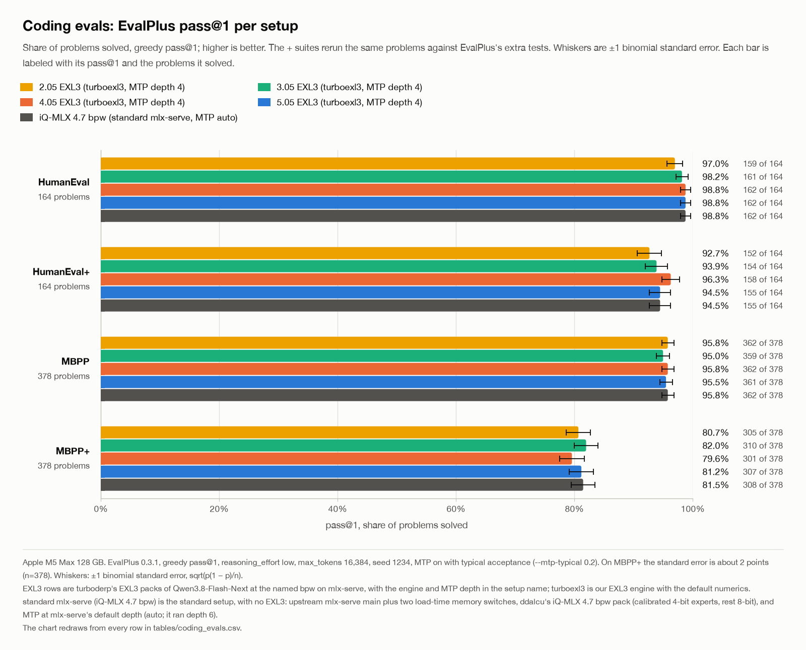
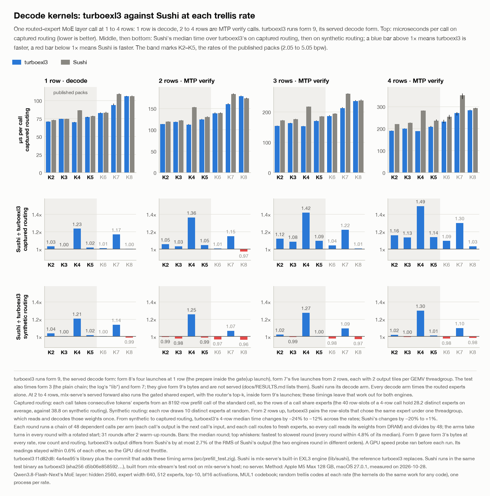
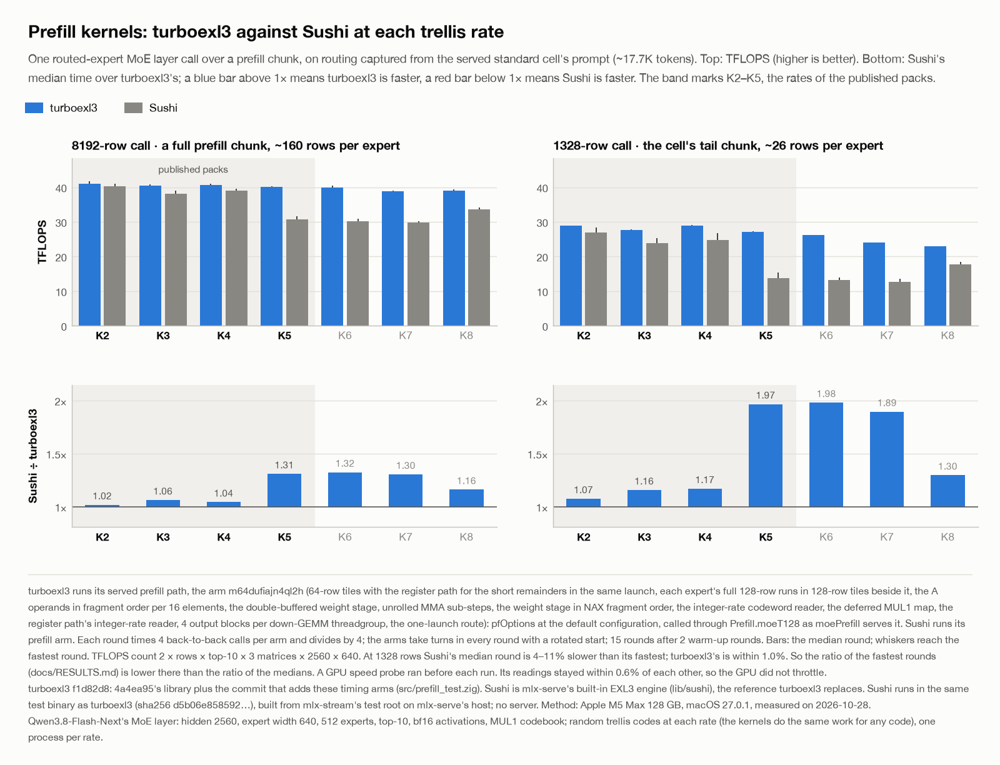

<h1 align="center">
  <picture>
    <source media="(prefers-color-scheme: dark)" srcset="docs/media-kit/turboexl3-lockup-animated-dark.svg">
    
  </picture>
</h1>

turboexl3 runs the projections of an EXL3-quantized LLM on Apple GPUs. It is a Zig library of Metal kernels that MLX
launches. The [glossary](docs/GLOSSARY.md) defines every term that these documents use.

## What it does

A model in the EXL3 format stores each weight as a trellis code of 1 to 8 bits. To use a weight, a kernel must
first decode its code into a number. turboexl3 decodes the codes inside its own kernels:

- **Routed experts of a mixture-of-experts layer.** At decode rows a chain of split-K GEMV launches serves them. At
  prefill rows a chain of GEMM launches serves them. Neither chain writes a decoded copy of the expert weights to
  memory.
- **Dense projections of the trunk.** These are the attention, GDN, shared-expert, `lm_head` and MTP projections.
  Up to 32 rows, the kernels decode the codes in registers (from 17 rows, only where the NAX gate holds). Above 32
  rows, the default path decodes the weight into an `f16` copy (W_hat) and runs MLX's matmul.
- **Fused launches around these projections.** A serving host uses them to cut the launches and dependent levels per
  layer.

One host reference holds every kernel to the same numbers: `format.project`, a port of Sushi's EXL3 reference. Each
kernel is in one of two classes:

- A kernel that replaces a chain of other kernels is **byte-identical** to that chain.
- A kernel that sums in its own order stays **within a stated tolerance** of `format.project`.

turboexl3 was written as the EXL3 engine of [mlx-stream](https://github.com/davidtai/mlx-stream), a plugin for
[mlx-serve](https://github.com/ddalcu/mlx-serve), to serve [Qwen3.8-Flash-Next](docs/GLOSSARY.md#qwen38) from
[turboderp](docs/GLOSSARY.md#turboderp)'s EXL3 packs,
[turboderp/Qwen3.8-Flash-Next-exl3](https://huggingface.co/turboderp/Qwen3.8-Flash-Next-exl3). Now it reaches mlx-serve
as an outside quant plugin. The folder [`plugin/`](plugin/build.zig) builds that plugin with mlx-serve's plugin kit.

The documents:

| document | what it holds |
|---|---|
| this README | the packs, the weight formats, the API, the source layout, the wiring, the configuration and the tests |
| [docs/RESULTS.md](docs/RESULTS.md) | the measured speed from 1K to 256K tokens and the coding scores, with mlx-serve; the kernel timings against Sushi |
| [docs/GLOSSARY.md](docs/GLOSSARY.md) | the definition of every term |
| [docs/KERNELS.md](docs/KERNELS.md) | every kernel, the chain of launches it replaces and how its output bits relate to that chain |
| [CONSUMING.md](CONSUMING.md) | what a consumer supplies, and how to build, check and install the quant plugin |
| [docs/media-kit](docs/media-kit/README.md) | the TurboEXL3 logo for light and dark grounds (SVG, animated SVG, PNG, GIF, social images), its colours and its use; the results as a 60 s animated infographic (MP4 and GIF) |

## The packs

turboexl3 is designed to work with the MLX versions of turboderp's packs. These are his EXL3 files, repacked into the
file layout that mlx-serve loads; nothing is quantized again. The repacks are made with
[qwen38-exl3-mlx-serve-converter](https://github.com/OpenSourceWTF/qwen38-exl3-mlx-serve-converter):

| bpw | turboderp's branch | MLX repack | download | KLD vs BF16 | perplexity |
|---|---|---|---:|---:|---:|
| 2.05 | [2.05bpw_h4_ng4](https://huggingface.co/turboderp/Qwen3.8-Flash-Next-exl3/tree/2.05bpw_h4_ng4) | [OpensourceWTF/Qwen3.8-Flash-Next-EXL3-2.05-mlx-serve](https://huggingface.co/OpensourceWTF/Qwen3.8-Flash-Next-EXL3-2.05-mlx-serve) | 63.1 GB | 0.0681 | 1.4871 |
| 3.05 | [3.05bpw_h5_ng5](https://huggingface.co/turboderp/Qwen3.8-Flash-Next-exl3/tree/3.05bpw_h5_ng5) | [OpensourceWTF/Qwen3.8-Flash-Next-EXL3-3.05-mlx-serve](https://huggingface.co/OpensourceWTF/Qwen3.8-Flash-Next-EXL3-3.05-mlx-serve) | 85.4 GB | 0.0174 | 1.4074 |
| 4.05 | [4.05bpw_h6_ng6](https://huggingface.co/turboderp/Qwen3.8-Flash-Next-exl3/tree/4.05bpw_h6_ng6) | [OpensourceWTF/Qwen3.8-Flash-Next-EXL3-4.05-mlx-serve](https://huggingface.co/OpensourceWTF/Qwen3.8-Flash-Next-EXL3-4.05-mlx-serve) | 107.6 GB | 0.0066 | 1.3897 |
| 5.05 | [5.05bpw_h6_ng6](https://huggingface.co/turboderp/Qwen3.8-Flash-Next-exl3/tree/5.05bpw_h6_ng6) | [OpensourceWTF/Qwen3.8-Flash-Next-EXL3-5.05-mlx-serve](https://huggingface.co/OpensourceWTF/Qwen3.8-Flash-Next-EXL3-5.05-mlx-serve) | 123.4 GB | 0.0040 | 1.3848 |

Each download includes the pack's n-gram table. The KLD and perplexity columns are turboderp's, read from the charts on
[his model card](https://huggingface.co/turboderp/Qwen3.8-Flash-Next-exl3): the mean KL divergence D_KL(p_BF16 ‖
p_quant) and the perplexity over a self-generated in-domain trace (14,496 input and 45,588 output tokens), measured with
exllamav3 on his files. On that trace BF16 has a perplexity of 1.38474, and the KLD noise floor is 0.00262. The repacks
hold the same files, but these numbers were not measured through mlx-serve. The measured speed and coding scores with
mlx-serve are in [docs/RESULTS.md](docs/RESULTS.md).

turboderp's charts, linked from [his model card](https://huggingface.co/turboderp/Qwen3.8-Flash-Next-exl3) (the EXL3 series is his plain quants; the packs above are its
2.05, 3.05, 4.05 and 5.05 points; EXL3-SC are his self-calibrated quants, the others are other formats he measured):


### Coding evals

EvalPlus 0.3.1 through mlx-serve on an M5 Max, the packs with turboexl3: greedy pass@1, `reasoning_effort: low`,
`max_tokens` 16,384, MTP on; solved problems in brackets, of 164 (HumanEval) and 378 (MBPP).

| pack | HumanEval | HumanEval+ | MBPP | MBPP+ |
|---|---:|---:|---:|---:|
| 2.05 bpw | 0.970 (159) | 0.927 (152) | 0.958 (362) | 0.807 (305) |
| 3.05 bpw | 0.982 (161) | 0.939 (154) | 0.950 (359) | 0.820 (310) |
| 4.05 bpw | 0.988 (162) | 0.963 (158) | 0.958 (362) | 0.796 (301) |
| 5.05 bpw | 0.988 (162) | 0.945 (155) | 0.955 (361) | 0.812 (307) |
| iQ-MLX 4.7 bpw, standard mlx-serve (no EXL3) | 0.988 (162) | 0.945 (155) | 0.958 (362) | 0.815 (308) |
| uncalibrated mixed 4/8-bit, superseded by the iQ pack | 0.988 (162) | 0.945 (155) | 0.952 (360) | 0.815 (308) |

Every pack is within two points of the standard pack on every suite.



The setups and the method in full: [docs/RESULTS.md](docs/RESULTS.md#coding-evals).

## Kernels against Sushi

These charts compare turboexl3's [routed-expert](docs/GLOSSARY.md#routed-expert) kernels with
[Sushi](docs/GLOSSARY.md#sushi)'s, one MoE layer call at a time, with no server. Sushi runs in the same test binary, on
the same weights, inputs and routing. Each chart covers the [rates](docs/GLOSSARY.md#rate) K2 to K8. The published packs
use K2 to K5.

- **Decode, 1 row**: turboexl3 runs [form](docs/GLOSSARY.md#form) 9, its served decode form. The call times the routed
  experts alone, as mlx-serve serves them at 1 row; its shared expert runs in the host's own chain.
- **[MTP verify](docs/GLOSSARY.md#mtp), 2 to 4 rows**: form 9 again, on the routed experts alone. In mlx-serve's served
  forward these calls also run the gated [shared expert](docs/GLOSSARY.md#shared-expert), with the router's top-k,
  inside form 9's launches. These timings leave that work out for both engines.
- **Prefill, 8192 rows or 1328 rows**: turboexl3 runs its served prefill path, `pfOptions` at the default configuration.
- **Routing**: captured from mlx-serve serving the 5.05 pack on a 17,743-token coding prompt, the standard test cell,
  which prefills as two 8192-row chunks, then a 1328-row chunk. The rows of a decode call share experts there. On
  synthetic routing, where the rows rarely share an expert, the decode ratio is lower; the bottom row of the decode
  chart shows it.





The ratio is Sushi's median time divided by turboexl3's, on captured routing. Above 1×, turboexl3 is faster.

| rate | decode, 1 row | verify, 2 rows | verify, 3 rows | verify, 4 rows | prefill, 8192 rows | prefill, 1328 rows |
|---|---:|---:|---:|---:|---:|---:|
| K2 (2.05 bpw pack) | 1.03× | 1.05× | 1.12× | 1.16× | 1.02× | 1.07× |
| K3 (3.05 bpw pack) | 1.00× | 1.03× | 1.08× | 1.13× | 1.06× | 1.16× |
| K4 (4.05 bpw pack) | 1.23× | 1.36× | 1.42× | 1.49× | 1.04× | 1.17× |
| K5 (5.05 bpw pack) | 1.02× | 1.05× | 1.09× | 1.14× | 1.31× | 1.97× |
| K6 | 1.01× | 1.01× | 1.04× | 1.09× | 1.32× | 1.98× |
| K7 | 1.17× | 1.15× | 1.22× | 1.30× | 1.30× | 1.89× |
| K8 | 1.00× | 0.97× | 1.01× | 1.03× | 1.16× | 1.30× |

At the rates of the published packs (K2 to K5), on captured routing:

- Decode (1 row): 1.00× to 1.23×.
- MTP verify (2 to 4 rows): 1.03× to 1.49×.
- Prefill, 8192 rows: 1.02× to 1.31×.
- Prefill, 1328 rows: 1.07× to 1.97×.
- Sushi is not faster than turboexl3 in any of these calls.
- The two take the same median time (1.00×) at: decode K3, 1 row.

On synthetic routing at K2 to K5, the ratios at 1 to 4 rows range from 0.98× to 1.30×. Sushi is faster at: verify K2, 2
rows (0.99×); verify K3, 2 rows (0.98×); verify K3, 3 rows (0.99×); verify K5, 2 rows (0.99×).
Across K2 to K8, Sushi is faster in 11 of the 28 synthetic cells at 1 to 4 rows.

The largest ratios come from rates where Sushi's own time rises. At 1 row, Sushi takes 86.2 µs at K4, against 74.3 µs at
K3 and 78.1 µs at K5; turboexl3 takes 69.9, 74.3 and 76.8 µs. At K7 Sushi takes 109.0 µs, against 83.1 µs at K6. At 8192
rows, Sushi runs at 38.1 to 40.2 TFLOPS at K2 to K4, then 29.7 to 30.7 TFLOPS at K5 to K7; turboexl3 stays at 38.8 to
40.9 TFLOPS at every rate.

[docs/RESULTS.md](docs/RESULTS.md#kernels-against-sushi) gives every arm's median and fastest round, on both routings,
and the commands that time the kernels again.

## Formats

- **Rates**: Every even n from 16 to 128, so K = n / 16 bits per weight from 1 to 8. Fractional rates are valid, for
  example n = 36 (K = 2.25) or n = 40 (K = 2.5). Each projection has its own rate. In an expert bank, gate and up
  must share one rate, and `moe` refuses a bank whose down rate differs.
- **Codebooks**: MUL1 and MCG (exllamav3's `codebook.cuh`), named `"mul1"` and `"mcg"` in a pack's config. The MUL1
  map can be deferred to the finish (see the [deferred MUL1 map](docs/GLOSSARY.md#deferred-map)).
- **Codeword windows**: From 8 to 16 bits. A pack names its window in the `window` field of `expert_quant`, or uses 16.
  `parseExpertQuant` refuses a width outside 8 to 16 with `error.Exl3WindowUnsupported`.
- **Layout**: A projection is a trellis `U16` `[in/16, out/16, n]` in the tensor-core tile permutation, with `suh`
  `F16` `[in]` and `svh` `F16` `[out]`. An expert bank adds the axis E: `[E, in/16, out/16, n]`, `[E, in]` and
  `[E, out]`. Input and output widths are multiples of 128.
- **Activations**: `bf16`, `f16` or `f32` in, and the output in the input's dtype. Some entry points take only `bf16`
  or `f16`: the fused shared expert and the attention entries. The indexer merge takes only `bf16`. Accumulation is
  `f32` everywhere. The rounding points are exllamav3's.

## API

`src/root.zig` is the module root. The expert entry points mirror Sushi's `sushi_exl3` module, so a host switches
engines by changing one import. An entry point that does not serve a call returns `error.Exl3EngineNotImplemented`
before it launches anything. The caller then runs its own chain. Malformed operands return `error.BadExl3Shape` or
`error.BadExl3Dtype`.

The configuration (see [Configuration](#configuration)):

| name | what it does |
|---|---|
| `Config`, `configure` | the choices of the process, set once before the first call; `configure` refuses a value that the library does not serve |

The contract of a pack (`spec.zig`, with Sushi's names and refusals):

| name | what it does |
|---|---|
| `Spec`, `parseExpertQuant` | read the `expert_quant` block of a pack's config: the rate, the codebook and the window |
| `admitTopK` | refuse a top-k above `REDUCE_MAX_TOPK` (32) with `error.Exl3TopKExceedsReduceBank` |
| `trellisAdmitted` | check a stacked trellis `[E, in/16, out/16, n]` against a bank's geometry and rate |
| `kernels` | `DECODE_ROWS_MAX` (16), `REDUCE_MAX_TOPK` (32), `usesPrefillArm`, `rowsOfShape` |

The routed experts:

| name | what it does |
|---|---|
| `Proj`, `Bank`, `Geometry`, `bankGeometry` | one projection's arrays, a bank's gate, up and down, and the geometry that the shapes give |
| `moe` | the routed experts of one MoE layer: decode rows through the split-K GEMV chain, prefill rows through the fused GEMM chain; its argument `verify_rows` is Sushi's and changes nothing here |
| `moeWithShared` | `moe`, then an MLX add of a shared-expert output that the caller has already gated |
| `moeClamped` | `moe` with DeepSeek-V4's (and GLM's) clamped SwiGLU, `swiglu_limit` 1 to 128: the gate clamped from above and up to [−limit, limit] before SwiGLU; decode rows on fin7's clamped variant, prefill rows on the clamped mid |

The shared expert and the router, at 1 to 4 decode rows:

| name | what it does |
|---|---|
| `moeFusedShared` | a gated shared expert inside the decode launches of the routed experts |
| `moeFusedSharedRouted` | the same, with the router's top-k and softmax folded into the prepare launch |

The dense projections:

| name | what it does |
|---|---|
| `linear` | one dense EXL3 projection. 1 to 4 rows: DEC-ONE. 5 to 16 rows: the multi-row GEMV chain of three launches, which decodes each weight once per row chunk: 5 rows in one chunk, 6 to 8 rows in one chunk on the lean GEMV, and 9 to 16 rows in two chunks. 17 to 32 rows: the register-path GEMM. More rows: dequantize, then MLX's matmul |
| `linearSplit` | `linear` with the inner product and the finish of prefill rows on a second MLX stream; the same bytes |
| `linearInnerSplit`, `linearPrepared`, `linearFinish`, `linearPrep` | `linear` in pieces, so the host can run its fused norm-gate of the GDN layers between them |
| `linearPiecesBegin`, `linearPieceInner`, `linearPiecePrepared`, `linearPiecesFinish` | `linear` of one call cut into 2 to 4 row pieces, so the host can overlap them with its own launches |
| `linearGrouped` | a grouped (block-diagonal) linear, DeepSeek-V4.1's `wo_a`: x `[..., G, in]` through G stacked slices. 1 to 16 rows: three launches whatever G. More rows: `linear` of each slice. Each slice has `linear`'s values |
| `linearBias` | `linear`, then an MLX add of a bias `[out]` in x's dtype (DeepSeek-V4.1's vision tower and aligner) |

The attention projections:

| name | what it does |
|---|---|
| `attnIn` | ATTN-IN: q, k and v with QK-norm and partial RoPE in the finish, at prefill rows |
| `attnPrep4`, `linearPreparedIdx` | ATTN-IN's prepare with the QSA indexer projection as a fourth member, and the indexer projection from its prepared copy |
| `linearGated` | ATTN-OUT: `o_proj` over the sigmoid-gated output of the attention core, at prefill rows |
| `decode_merge` | at decode rows: `decodeMergeGated`, `decodeMergeQmergeGated` (with the QSA merge), `decodeMergeQPlanes`, `decodeMergeIndexer` |

The resident and un-rotated trunk:

| name | what it does |
|---|---|
| `dense.residentArm` | keep the W_hat of each admitted trellis after its first call on the matmul path (more than 32 rows by default); the same bytes as a dequantize per call |
| `dense.residentRelease`, `residentPending`, `residentStats`, `residentKeeps` | drop the kept arrays, the bytes admitted but not kept yet, the counts, and whether one trellis is kept |
| `trunkUnrot`, `UnrotStats` | at load, put W_std in the activation dtype (`bf16` or `f16`) in place of each admitted trellis's W_hat; opt-in, with a different rounding |
| `dense.residentUnrot`, `residentStd`, `residentJoined` | whether a trellis has a W_std, its W_std, and its joined W_std (up to 4 projections that read one x, joined along the outputs) |
| `attnInStd`, `linearGatedStd` | ATTN-IN and ATTN-OUT over the un-rotated trunk |

The namespaces are `config`, `format` (the reference), `spec`, `lane` (the codeword readers), `decode`, `dense`,
`grouped`, `prefill`, `attn_io`, `decode_merge`, `unfused` and `ref`. The doc comment of each function states its
shapes, its dtypes, the chain whose bytes it gives and when it refuses.

## Source layout

| path | what it holds |
|---|---|
| `src/root.zig` | the module root, with the API above |
| `src/config.zig` | `Config` and `configure` |
| `src/kernels/<module>/<name>.metal` | the Metal text of each kernel; `<module>` is the name of the Zig file that launches it, without `.zig` |
| `src/kernels/steel_nax.metal` | four steel headers of MLX 0.32.2, inlined, for the prefill and dense GEMMs |
| `src/steel.zig` | the steel headers that the GEMMs use: the consumer's (`sdk.steel`), else `steel_nax.metal` |
| `src/kernels/test/` | the Metal texts of the tests: `pins/` holds what a test looks for in the kernels, and `dump/` the parts of the Metal dumps |
| `plugin/` | the mlx-serve quant plugin ([CONSUMING.md](CONSUMING.md)) |
| `tools/check_texts.py` | a check that runs on the host, with no Zig: no Metal in a Zig file, and no kernel text changed by a refactor |
| `AGENTS.md` | the rules for a change to this repository; `CLAUDE.md` points to it |

No Metal goes inside a Zig file. Each Zig file imports its Metal texts with `@embedFile`. A variant of a kernel is a
composition, not a search and replace. The base text is cut into numbered pieces (`x_1.metal`, `x_2.metal`, ...), and
the variant joins other pieces between them. [AGENTS.md](AGENTS.md) gives these rules.

## Wiring

turboexl3 imports `std` and one module that its consumer supplies, named `sdk`:

```zig
// sdk
pub const mlx = ...;            // mlx-c's bindings (mlx_array, mlx_stream, mlx_reshape, mlx_fast_metal_kernel_config_*, ...)
                                //   plus check(c_int) !void, getShape(mlx_array) []const c_int, streamIsGpu(mlx_stream) bool
pub const kernel_launch = struct {
    pub const TemplateValue = union(enum) { int: i32, dtype: mlx.mlx_dtype };
    pub const TemplateArg = struct { name: [:0]const u8, value: TemplateValue };
    /// one launch: grid (threads), threadgroup, output shapes and dtypes, template arguments
    pub const Launch = struct { grid: [3]u32, threadgroup: [3]u32, out_shapes: []const []const c_int, out_dtypes: []const mlx.mlx_dtype, template: []const TemplateArg };
    /// an MLX fast Metal kernel over `source` with `header` (input / output names in signature order); null when MLX refuses it
    pub fn newKernel(name: [*:0]const u8, inputs: []const [*:0]const u8, outputs: []const [*:0]const u8, source: [*:0]const u8, header: [*:0]const u8, ensure_row_contiguous: bool) ?mlx.mlx_fast_metal_kernel;
    /// the MLX config of a launch (the caller frees it)
    pub fn buildConfig(l: Launch) error{MlxError}!mlx.mlx_fast_metal_kernel_config;
    /// one launch on `stream`; `outs` receives new arrays (the caller frees them)
    pub fn applyConfig(kernel: mlx.mlx_fast_metal_kernel, config: mlx.mlx_fast_metal_kernel_config, inputs: []const mlx.mlx_array, outs: []mlx.mlx_array, stream: mlx.mlx_stream) error{MlxError}!void;
};
/// optional: MLX's steel NAX headers from the consumer's pinned MLX (each the file's text: `defines`, `type_traits`,
/// `integral_constant`, `nax`); without it the prefill GEMMs take the vendored copy (`steel_nax.metal`, MLX 0.32.2)
pub const steel = ...;
```

The members of `sdk`:

- `mlx`: mlx-c's bindings, plus three helpers: `check`, `getShape` and `streamIsGpu`.
- `kernel_launch`: `newKernel` makes a kernel, `buildConfig` makes the config of a launch, and `applyConfig` runs one
  launch. An optional `mlx_fast_metal_kernel_free` drops a kernel that `newKernel` made.
- `steel` (optional): the four steel headers of the consumer's own MLX. An MLX update that changes them then reaches
  the kernels. Without `steel`, the GEMMs use `src/kernels/steel_nax.metal`.

The plugin's `plugin/sdk.zig` is such a module:

- Its `kernel_launch` gets each kernel from mlx-serve's kernel cache (`Host.kernel`). The cache keeps one kernel
  object for each name and text, for the life of the process.
- It launches each kernel through mlx-serve's launcher (`HostGpu.launch`). The launcher runs MLX's own compiled
  pipeline, but it skips the source generation and hashing that MLX does on each launch. The results are the same.
- Its `mlx` (`plugin/mlx.zig`) declares the mlx-c functions that turboexl3 calls, with Zig types. They resolve
  against the server's libmlxc when the server loads the plugin.
- It declares no `steel`, because the plugin kit has no steel headers.
- It declares no `mlx_fast_metal_kernel_free`, because the server's kernel cache owns every kernel.

turboexl3 keeps its kernels in caches, one per geometry, for the life of the process. It drops a kernel only through
`decode.freeKernel`, on an error path or when it frees a cache. That function calls
`kernel_launch.mlx_fast_metal_kernel_free` when the consumer declares it. mlx-stream's version removes the kernel's
launch-cache entry, then frees the kernel. Without that member, turboexl3 frees no kernel: the consumer keeps them.

A launcher can also add Metal defines to the start of each header. Each header holds the default of each define, and
the defaults are the served values. The plugin passes each header as given. The other values are A/B variants:

| define | default | what it selects | output bits |
|---|---|---|---|
| `EXL3_T1V` | 3 | the route from MUL1's two pair sums to t, from 0 to 3; every route is exact | unchanged |
| `EXL3_R64` | 1 | 1: each lane reads its codewords from one 64-bit window (n ≤ 108) or from three words (n ≤ 128); 0: the reader with a per-lane extract (`IntWords`) | unchanged |
| `EXL3_KU` | 0 | 1: the decode GEMV loads its input tiles in pairs | unchanged |

To use the package, add it to the consumer's `build.zig.zon` and add these lines to its `build.zig`:

```zig
const t3 = b.dependency("turboexl3", .{ .target = target, .optimize = optimize }).module("turboexl3");
t3.addImport("sdk", sdk);
consumer.addImport("turboexl3", t3);
```

[CONSUMING.md](CONSUMING.md) shows the wiring of the plugin.

## Configuration

turboexl3 reads no environment. A consumer sets its choices once, before the first call, with
`turboexl3.configure(.{ ... })`. The argument is one `Config` (`src/config.zig`). The default of each field is the
served configuration.

`configure` refuses a value that the library does not serve with `error.InvalidTurboexl3Config`, and then it changes
nothing. A kernel cache keeps what it built. So a change after the first launch reaches only the geometries that later
calls build.

| field | default | what it controls | output bits |
|---|---|---|---|
| `decode_form` | 9 | the form of the decode chain of the routed experts: 3, 5, 6, 7, 8 or 9 | unchanged, tested: forms 5–9 give the bytes of form 3 |
| `shared_spt` | 4 | the fused shared expert: K slices per gate and up GEMV threadgroup, of its 20: 1, 2, 4, 5, 10 or 20 | unchanged, tested |
| `fused_fin_fold` | true | the fused shared expert from two rows: the finishes of the gate and up planes (`fin7s`) run in the gate and up launch (`turboexl3_gu3sf`), in the threadgroups that complete each block; false: `gu3s` then `fin7s` | unchanged, tested |
| `pf_alay` | 2 | prefill: the A layout of the GEMMs: 0 natural; 1 fragment order per 32 elements; 2 fragment order per 16 elements | unchanged, tested |
| `pf_t128` | true | prefill: each expert's full runs of 128 rows in 128-row tiles | unchanged, tested |
| `prefill` | true | false: `moe` refuses prefill rows with `error.Exl3EngineNotImplemented` | not applicable |
| `nax` | true | whether the device passes the NAX gate; the consumer tells. False turns off every kernel that uses the NAX: `moe` refuses prefill rows, and a dense call of 17–32 rows takes dequantize + MLX's matmul | can differ: those dense rows sum in another order |
| `dec_one` | true | DEC-ONE for dense projections at decode rows; false: the three-launch chain | unchanged, tested |
| `dense_lean` | true | the row chunks of the dense GEMV chain: up to 8 rows, and a chunk of 6 to 8 rows on the lean GEMV (its codeword loop by input element, so fewer live registers); false: up to 5 rows, all on the plain GEMV | unchanged, tested |
| `slot_stats` | false | a diagnostic: it reads the routing of each decode call back to the host (a sync per call). Every 480 calls it prints how often the row-slots of a call repeat an expert. The router fold refuses while it is on | unchanged |
| `pf_capture_dir` | null | a diagnostic: a directory; the routing of the first 512 prefill calls goes there (a sync per call) | unchanged |

The "output bits" column has these values:

- **unchanged, tested**: the field moves work only, and a GPU test compares the bits of the settings.
- **unchanged**: the field moves work only, as the source states, but no GPU test compares the bits.
- **can differ**: the setting can change the bits.

Every other launch shape is a constant of the file that reads it (`root.zig`, `dense.zig`, `decode.zig`). This
includes the prefill tiles, the GEMV tiles and K splits, the deferred MUL1 map and the dense paths. The tests also
build other values of these constants, as variants.

The plugin sets one field: `nax`, from turboexl3_kit's test of the NAX gate (`kit/nax.zig`).

## Tests

`src/tests.zig` is the test root. The tests import `sdk` and `mlx_host`, the host surface. When the host exports
`mlx_host.sushi_exl3`, Sushi is a second reference. So a consumer builds the tests over its own surface, with the
`testModule` function of `build.zig`. The plugin kit cannot run them: a kit plugin builds only its dylib and its
MLX-free tests.

The library reads no environment, but the tests do. These variables turn on test groups:

| variable | file | what it runs |
|---|---|---|
| none | every file | the CPU tests: the kernel texts, the launch plans, the tables and the reference |
| `TURBOEXL3_GPU=1` | `gpu_test.zig`, `prefill_test.zig`, `attn_io_test.zig`, `decb_test.zig`, `clamped_test.zig`, `deepseek_test.zig`, `topk_test.zig`, `bench.zig` | the GPU parity and byte tests, on a Metal device |
| `TURBOEXL3_METAL_DUMP=1` | `prefill.zig` | prints each kernel of the routed prefill chain, with its option variants, as one standalone source file for an offline `xcrun metal` compile |
| `TURBOEXL3_BENCH=1` | `bench.zig` | with `TURBOEXL3_GPU=1`: times the form-3 variants of the decode chain against Sushi's chain |
| `TURBOEXL3_PF_TIME=1`, `TURBOEXL3_DEC_TIME=1` | `prefill_test.zig` | with `TURBOEXL3_GPU=1`: time the prefill and decode chains against Sushi's |
| `TURBOEXL3_DS_TIME=1` | `deepseek_test.zig` | with `TURBOEXL3_GPU=1`: times DeepSeek-V4.1's clamped routed MoE (K3, K2; decode rows and a 4096-row chunk), its K6 trunk linears and the grouped `wo_a` |
| `TURBOEXL3_DENSE_TIME=1` | `gpu_test.zig` | with `TURBOEXL3_GPU=1`: times the dense GEMV against the row-slot GEMV and MLX's 8-bit affine matmul |
| `TURBOEXL3_REAL_SHARD=<file>` | `gpu_test.zig` | with `TURBOEXL3_GPU=1`: runs `linear` on two real trellises of a trunk shard of the full pack |
| `TURBOEXL3_PERM_FILE=<file>` | `gpu_test.zig` | a CPU-only tool: the column order of the trunk, the EXL3 pack against the affine pack |

These variables set or narrow the cases of a test group. The comments of each file give their values:

| variables | file | what they narrow |
|---|---|---|
| `TURBOEXL3_BENCH_N`, `_ROWS`, `_ARMS`, `_ROUNDS` | `bench.zig` | the decode benchmark |
| `TURBOEXL3_PF_E`, `_ROWS`, `_N`, `_CALLS`, `_ROUNDS`, `_SKEW`, `_ARMS`, `_INDS`, `_STAGES` | `prefill_test.zig` | the prefill parity and timing |
| `TURBOEXL3_DEC_E`, `_ROWS`, `_LAYERS`, `_ROUNDS`, `_INDS` | `prefill_test.zig` | the decode timing |
| `TURBOEXL3_DENSE_TIME_PREFILL`, `_TAIL`, `_MULTI_ONLY` | `gpu_test.zig` | the dense timing: prompt-chunk rows, the rows of a snapshot tail, or the multi-row GEMV alone |
| `TURBOEXL3_SHARED_V2` | `gpu_test.zig` | the configurations of the v2 shared heads |
| `TURBOEXL3_ATTN_ROWS` | `attn_io_test.zig` | the row counts of the attention tests |
| `TURBOEXL3_CLAMP_N`, `_ROWS` | `clamped_test.zig` | the rates (halfwords per tile) and row counts of the clamped SwiGLU's test at DeepSeek-V4.1-Flash's geometry |

`python3 tools/check_texts.py <src before the change>` checks a refactor on the host. It fails on any Zig string that
holds Metal. It also proves that each kernel source and header is byte-identical to the one before the change, or
equal except for comments and whitespace. It names each kernel of the second kind, each kernel that the change
removed, and each kernel that the change added (its list `ADDED_KERNELS`). With the current `src` as both trees, it
runs only the scan for Metal.

## License

MIT (LICENSE). Third-party material and its licenses: NOTICE.
