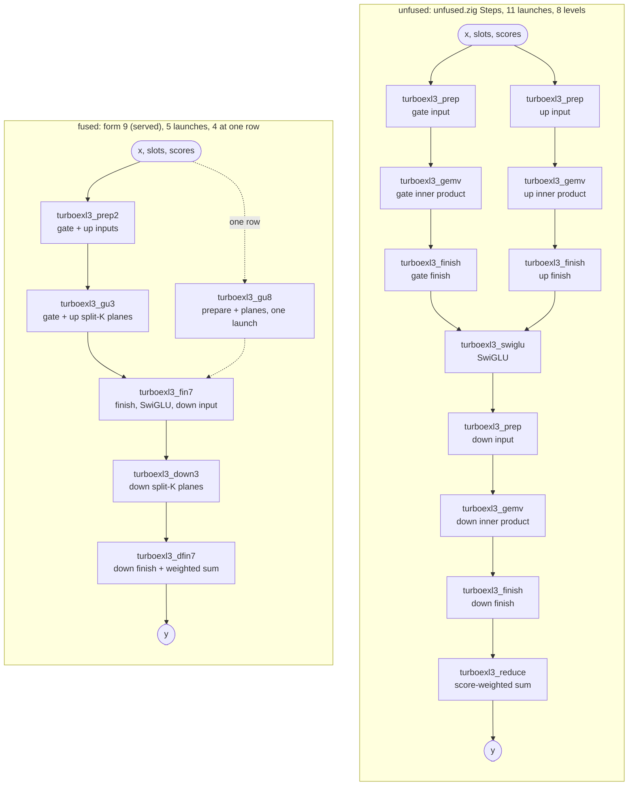
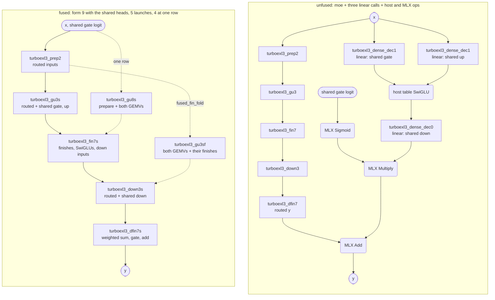
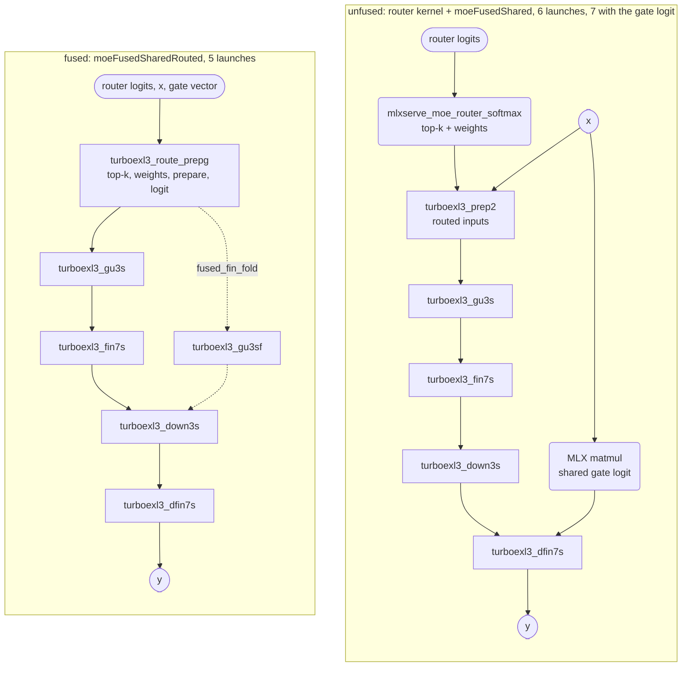
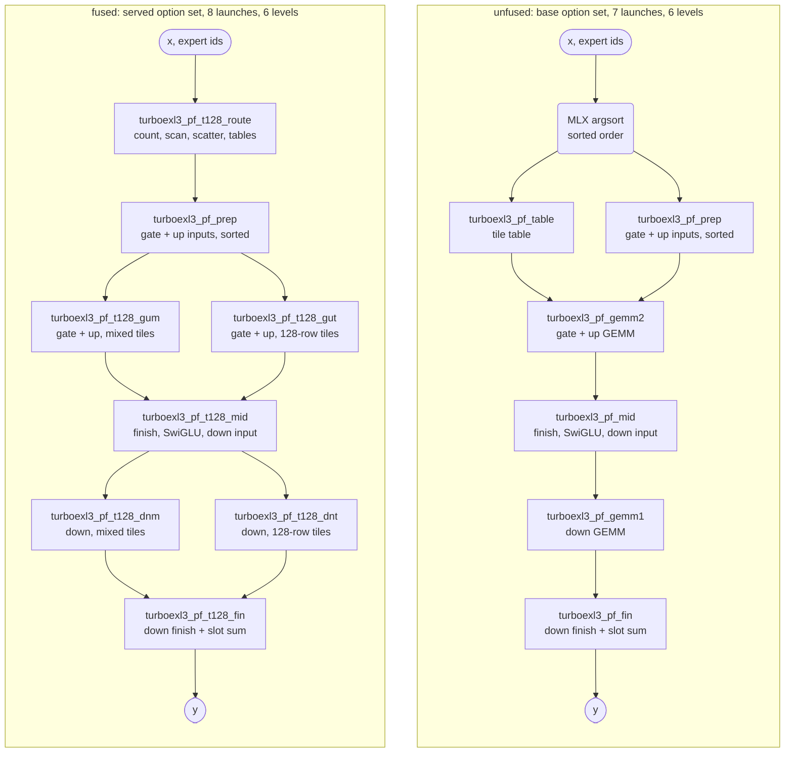
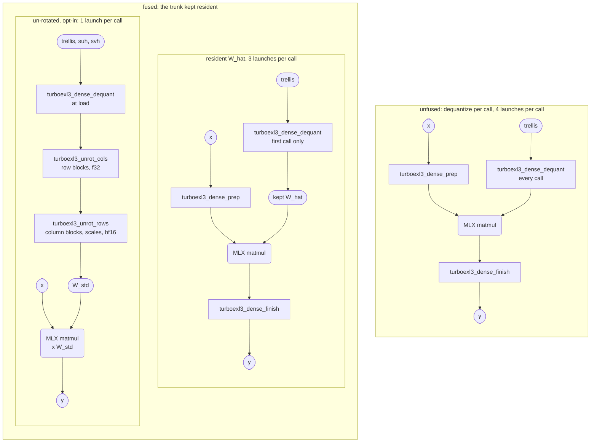
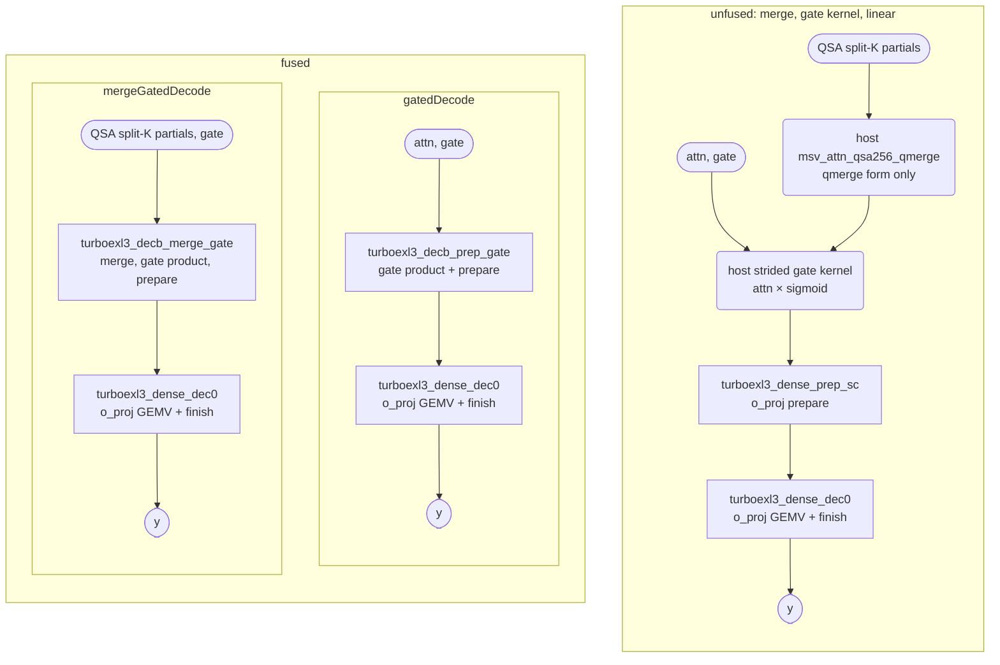

# turboexl3 kernels

This page lists every [Metal](GLOSSARY.md#metal) kernel that turboexl3 registers with [MLX](GLOSSARY.md#mlx), by the
name that it passes to `newKernel`. For each [fused path](GLOSSARY.md#chain), the page shows the chain of
[launches](GLOSSARY.md#launch) that the path replaces. It also tells why the fused path is faster and how its output
bits relate to that chain.

The Metal text of each kernel is a file `src/kernels/<module>/<name>.metal`. There `<module>` is the name of the Zig
file that launches the kernel, without `.zig`. The steel headers lie directly in `src/kernels/` (`steel_nax.metal`),
and the texts of the tests lie in `src/kernels/test/`. A Zig file imports each text with `@embedFile`. A kernel can
be several numbered pieces that the Zig file joins, for example `gu3_1.metal` and `gu3_2.metal`.

The file headers (`//!`) and the `///` comments in `src/` hold the full statements; this page is the map. The
[glossary](GLOSSARY.md) defines every term, and a link marks the first use of a term on this page. The
[Configuration](../README.md#configuration) section of the README gives the choices of a
[consumer](GLOSSARY.md#consumer).

## How to read this page

### The three stages of an EXL3 projection

Every [EXL3](GLOSSARY.md#exl3) projection has three stages. [`format.project`](GLOSSARY.md#format-project) runs them for
one [row](GLOSSARY.md#row) on the CPU, and every kernel is held to it. [H128](GLOSSARY.md#h128) includes its scale of
1/√128.

| stage | what it computes | where it rounds |
|---|---|---|
| [prepare](GLOSSARY.md#prepare) | `xp = H128(f16(x) · suh)`, per 128-element block of x | x to [`f16`](GLOSSARY.md#float-types), then xp to `f16` |
| [inner product](GLOSSARY.md#inner-product) | `z = xp · W_hat`, with `f32` accumulation | z to `f16` |
| [finish](GLOSSARY.md#finish) | `y = H128(z) · svh`, per 128-element block of z | y to `f16`, then to the output [dtype](GLOSSARY.md#dtype) |

Other terms on this page:

- **mid**: The work between the gate and up [GEMV](GLOSSARY.md#gemv-gemm) and the down GEMV. It is the gate and up
  finishes, [SwiGLU](GLOSSARY.md#swiglu) in `f32`, and the prepare of the down input.
- **planes**: The [split-K](GLOSSARY.md#split-k) partial sums, one `f32` plane per K slice. A finish adds them in slice
  order.
- **block sums**: The sum of each 128-element block of a row's prepared input. The [deferred MUL1
  map](GLOSSARY.md#deferred-map) needs them for its `C × Σx` term.
- **K span**: The part of the input dimension that one [threadgroup](GLOSSARY.md#threadgroup)'s K slices cover.
- **quad**: Four neighboring [lanes](GLOSSARY.md#lane) that hold one output column. Two shuffles fold their partial sums
  together.
- **T**: The activation dtype of a call, `bf16` or `f16`.
- **deferred MUL1 map**: The GEMVs and GEMMs multiply by [MUL1](GLOSSARY.md#mul1)'s byte sum t, and the finish applies
  `A × acc + C × Σx` once per output. It is always on for MUL1 [packs](GLOSSARY.md#pack). The tests also run chains with
  the map off: each weight then rounds to `f16`, as in the reference.

### Exactness classes

Each kernel is in one of three classes:

| class | what it means | why it holds | kernels in the class |
|---|---|---|---|
| [byte-identical](GLOSSARY.md#byte-identical) to a chain | every output element has the bit pattern of that chain's output | the kernel runs the chain's statements, in the chain's order, on the same values; only the launch shape changes | decode [forms](GLOSSARY.md#form) 5–9 (to form 3); the heads of the [shared expert](GLOSSARY.md#shared-expert) and the [router](GLOSSARY.md#router) fold (to the [host](GLOSSARY.md#host) chain); the fin fold of the shared expert (to `gu3s` and `fin7s`); [DEC-ONE](GLOSSARY.md#dec-one) (to the three-launch chain); the lean GEMV (to `dgemv`); the prefill options that only move work, and the 128-row tiles (to the option set without them); the [resident W_hat](GLOSSARY.md#resident-trunk) (to a dequantize per call); `linearSplit` and the `linear` pieces (to `linear`); [ATTN-IN](GLOSSARY.md#attn-in-out), ATTN-OUT and the four-member prepare (to the host chain); every decode-row merge (to the host chain); the clamped variants where no value reaches the limit (to the unclamped kernels) |
| [within tolerance](GLOSSARY.md#within-tolerance) of `format.project` | the ratio from [`ref.compare`](GLOSSARY.md#ref-compare) is at most the stated bar | the kernel rounds where `format.project` rounds, but it sums in its own order, and `f32` addition is not associative | decode forms 1 and 3; the dense GEMV chain; the inner products of the [register path](GLOSSARY.md#register-path), the fused GEMM and dequantize + matmul; the routed prefill chain; the clamped routed chains (to `ref.moeRowClamped`). The routed chains also sum in an order other than [Sushi](GLOSSARY.md#sushi)'s |
| opt-in, its own rounding | within the stated bars | each weight rounds once to the activation dtype, and each output rounds once | the [un-rotated trunk](GLOSSARY.md#unrotated-trunk): `turboexl3_unrot_*` at load, then one plain matmul; the `_std` attention kernels |

A byte test compares bit patterns. A tolerance test uses `ref.compare`: the largest |got − ref| over the output,
divided by the root mean square of the reference output.

The chains do not all compute the sigmoid of SwiGLU with the same function:

| chain | sigmoid of SwiGLU |
|---|---|
| the decode forms and the unfused steps | `metal::exp`, whose precision follows the math mode of the compiler |
| the mid of the routed prefill | `metal::precise::exp` |
| the fused shared expert (section 2) | the host's sigmoid table, in the output dtype |

So the SwiGLU of one row can round differently at [decode rows](GLOSSARY.md#decode-prefill-rows) and at prefill rows.

### Reading the diagrams

Each diagram puts the chain that a path replaces (the unfused side) beside turboexl3's launches (the fused side).

| shape | meaning |
|---|---|
| rectangle | a turboexl3 launch, labeled with its MLX kernel name |
| rounded box | an MLX or host operation |
| stadium (a box with round ends) | a tensor |
| arrow | a data dependency |
| dotted arrow | an alternative path |

A diagram leaves out an arrow that a longer path implies. So the longest path in a diagram is its number of dependent
levels.

## Kernel families

| family | entry points | rows | Zig file |
|---|---|---|---|
| decode GEMV of the [routed experts](GLOSSARY.md#routed-expert) | `moe`, `moeClamped` | 1–16 | `decode.zig` |
| shared expert and router in the decode launches | `moeFusedShared`, `moeFusedSharedRouted` | 1–4 (router fold: 2–4) | `decode.zig` |
| prefill GEMM of the routed experts | `moe`, `moeClamped` | 17+ | `prefill.zig` |
| dense projections | `linear`, `linearSplit`, the `linear` pieces, `trunkUnrot` | any | `dense.zig` |
| attention projections | `attnIn`, `attnPrep4`, `linearPreparedIdx`, `linearGated`, `attnInStd`, `linearGatedStd` | 17+ | `attn_io.zig` |
| decode-row merges | `decodeMergeGated`, `decodeMergeQmergeGated`, `decodeMergeQPlanes`, `decodeMergeIndexer` | 1–16 | `decb.zig` |

---

## 1. Routed experts at decode rows (1–16)

For a call of up to `DECODE_ROWS_MAX` (16) rows, `moe` runs the routed experts of an [MoE](GLOSSARY.md#moe) layer as a
chain of GEMV launches. Each [row-slot](GLOSSARY.md#row-slot) runs its expert's gate and up projections, SwiGLU and the
down projection. A finish then sums the outputs of each row's slots, weighted by their scores.

**What it replaces.** The unfused chain is `Steps` in `unfused.zig`. For each projection it runs a prepare, a raw GEMV
of the [trellis](GLOSSARY.md#trellis) and a finish, and then SwiGLU and the score-weighted reduce. That is 11 launches
in 8 [dependent levels](GLOSSARY.md#dependent-level). Its kernels read the same lane plan and decoders as the fused
forms, so a comparison of the two measures fusion alone. No test or benchmark runs it today.

**Why it is faster.** Form 9, the served form, merges the steps that share data:

- One launch prepares both the gate and the up inputs.
- One launch runs the mid: the gate and up finishes, SwiGLU and the prepare of the down input.
- One launch runs the down finish and the score-weighted sum.
- At one row, the prepare moves into the gate and up GEMV launch.

So form 9 runs 4 launches in 4 levels at one row, and 5 in 5 from two rows, against 11 in 8. Its split-K planes put
enough threadgroups in flight at one row. From two rows up, two row-slots that chose one expert share one decode of its
weights.

Compare the depths of the two columns. The unfused chain is 8 levels deep, and form 9 is 4 levels deep at one row and
5 from two rows. The dotted arrow is form 9's path at one row, where `turboexl3_gu8` also runs the prepare.

| kernel | what it computes | launches it replaces |
|---|---|---|
| `turboexl3_prep2` | the gate and up inputs, prepared in [lane order](GLOSSARY.md#lane-order), with the block sums of each | `turboexl3_prep` × 2 |
| `turboexl3_gu3` | the gate and up inner products as split-K planes, `f32` `[KS, row-slots, inter]`; from two rows up, two row-slots that chose one expert share one decode of its weights | `turboexl3_gemv` × 2 |
| `turboexl3_gu8` | `prep2` and `gu3` in one launch: each threadgroup prepares its own K span in [threadgroup memory](GLOSSARY.md#threadgroup-memory) | `turboexl3_prep` × 2, `turboexl3_gemv` × 2 |
| `turboexl3_fin3` | the planes added in slice order, the deferred map, the gate and up finishes, SwiGLU in `f32`, then the down input prepared, with its block sums | `turboexl3_finish` × 2, `turboexl3_swiglu`, `turboexl3_prep` |
| `turboexl3_fin7` | the statements of `fin3`, in the order of `fin3`, with the H128s in registers (no threadgroup exchanges) | as `fin3` |
| `turboexl3_fin7c` | `fin7` with the clamped SwiGLU (`moeClamped`): its SwiGLU line swapped for the clamp, the template int `LIMIT` | as `fin3` |
| `turboexl3_down3` | the down inner product as split-K planes | `turboexl3_gemv` |
| `turboexl3_dfin3` | for each (block of hidden, row): each slot's planes added, the deferred map and the finish, then an `fma` with the slot's score, in slot order; y in x's dtype | `turboexl3_finish`, `turboexl3_reduce` |
| `turboexl3_dfin7` | `dfin3` with the slots finished side by side (one [simdgroup](GLOSSARY.md#simdgroup) each), then the same chain of score `fma`s | as `dfin3` |
| `turboexl3_gu5` | form 5: the inputs of an expert group (up to 4 row-slots) prepared in threadgroup memory, then the GEMV of `gu3` for every member from one decode | `turboexl3_prep` × 2, `turboexl3_gemv` × 2 |
| `turboexl3_dn5` | form 5: the mid of `fin3` for every member, the down GEMV in the partition of `down3`, then each slot finished up to its score (`f16`) | `turboexl3_finish` × 3, `turboexl3_swiglu`, `turboexl3_prep`, `turboexl3_gemv` |
| `turboexl3_red5` | form 5: the chain of score `fma`s, in slot order | `turboexl3_reduce` |
| `turboexl3_dn6` | form 6: `dn5`, then the slot that arrives last at its (row, block of hidden) runs the chain of `red5`; an integer [counter](GLOSSARY.md#arrival-counter) counts the arrivals | as `dn5`, plus `turboexl3_reduce` |
| `turboexl3_gu` | form 1: the inputs prepared in threadgroup memory, the gate and up GEMV, the finishes and SwiGLU; h in `f32` | `turboexl3_prep` × 2, `turboexl3_gemv` × 2, `turboexl3_finish` × 2, `turboexl3_swiglu` |
| `turboexl3_down` | form 1: for each (block of hidden, row), each slot's down prepare, GEMV, finish and score `fma`, in slot order | `turboexl3_prep`, `turboexl3_gemv`, `turboexl3_finish`, `turboexl3_reduce` |
| `turboexl3_prep`, `turboexl3_gemv`, `turboexl3_finish`, `turboexl3_swiglu`, `turboexl3_reduce` | the unfused steps (`unfused.Steps`) | — |

| form | launches | levels | kernels | output bits |
|---|---|---|---|---|
| unfused (`unfused.Steps`) | 11 | 8 | `prep` × 2, `gemv` × 2, `finish` × 2, `swiglu`, `prep`, `gemv`, `finish`, `reduce` | the arithmetic of form 1 as separate steps; no test runs it |
| 1 (`Kernels`) | 2 | 2 | `gu` → `down` | its own order; `moe` cannot select it, but the GPU parity test runs it |
| 3 | 5 | 5 | `prep2` → `gu3` → `fin3` → `down3` → `dfin3` | its own split-K order: the bytes that forms 5–9 keep |
| 5 | 3 | 3 | `gu5` → `dn5` → `red5` | form 3's |
| 6 | 2 | 2 | `gu5` → `dn6` | form 3's |
| 7 | 5 | 5 | `prep2` → `gu3` → `fin7` → `down3` → `dfin7` | form 3's |
| 8 | 4 | 4 | `gu8` → `fin7` → `down3` → `dfin7` (form 7 where `gu8` is not admitted) | form 3's |
| **9 (served)** | 4 at one row, 5 from two | 4 / 5 | one row: `gu8` → `fin7` → `down3` → `dfin7`; 2–16 rows: `prep2` → `gu3` → `fin7` → `down3` → `dfin7` | form 3's |

**The choice of form.** The field `decode_form` of `Config` picks the form, and the default is 9. At one row
(`gu8_rows`), form 9 uses `turboexl3_gu8` when a threadgroup's K span is 128-aligned (`gu8Admitted`). It stops at one
row for a reason: `gu8` rotates its whole K span again in each threadgroup of output tiles. That cost grows once a
threadgroup carries several slices. Form 9 has its own launch shape (`bt1`, `bt9`, `kdiv9`: the output tiles and K
slices per threadgroup), and that launch shape changes no sum.

**Exactness.**

- Forms 1 and 3 are within tolerance of `format.project`. They round where it rounds, but they sum in their own order:
  - Form 1 splits the input dimension four ways in each threadgroup.
  - Form 3 splits it into a partition that is fixed per geometry. Gate and up split into KS slices × 2 parts, and down
    splits into KS2 slices × 4 parts. It adds the planes in slice order, and with MUL1 it applies the deferred map.
  - In the served setting, each partition starts at 4 slices and halves until its parts divide the input tiles
    evenly. Each down part keeps at least 2 tiles. At 2560 × 640, KS is 4 (20 input tiles per part) and KS2 is 2 (5
    tiles per part).
  - The bars: form 1 is within 5e-3 in `f32` ([rates](GLOSSARY.md#rate) n 32–128, MUL1 and [MCG](GLOSSARY.md#mcg), a
    12-bit window). `root.moe` (form 9, `bf16` x and y) is within 1.5e-2.
- The bytes of a form-3 row do not depend on how many rows share the call. The partition belongs to the geometry
  alone. The row count sets only how many threadgroups share the slices of a row-slot. The GPU test runs each row alone
  and then rows 2–16 together. It groups row-slots by expert and runs both MUL1 decodes (the deferred map on and off).
  This matters for [MTP](GLOSSARY.md#mtp): the number of verify rows changes, but a row's output must not.
- Forms 5–9 are byte-identical to form 3. They keep its partition and its order of FMAs per lane (input tiles in order,
  weights m = 0..7). They also keep its quad folds, its part sums and its [rounding points](GLOSSARY.md#rounding-point).
  Only the launch shape moves:
  - the tiles and slices per threadgroup;
  - the expert groups;
  - the launch that runs the prepare;
  - H128 in registers or through threadgroup memory.
- The GPU tests compare the bits of forms 5–9 with form 3 at rows 1–5, 8 and 16. They use several settings of tiles,
  K divisors and grouping, and both MUL1 decodes. Forms 5 and 6 run in `f32`; forms 7–9 run in `f32` and `bf16`.
- Every form computes SwiGLU in `f32` with `metal::exp`, as the unfused `turboexl3_swiglu` does. The prefill mid uses
  `metal::precise::exp` (section 3).

**The clamped SwiGLU.** `moeClamped` is `moe` with DeepSeek-V4's (and GLM's) `swiglu_limit` L: before SwiGLU, each
row-slot's gate is clamped from above at L and its up to [−L, L], in `f32` on the finished `f16` values (an integer L is
exact in `f16`). L is part of the geometry (`decode.Geometry.limit`), so a clamped call has its own cached kernels; only
fin7 changes: `turboexl3_fin7c` is `fin7` with its SwiGLU line (`fin7_swiglu.metal`) swapped for the clamp
(`fin7_swiglu_clamp.metal`), and its launch passes `LIMIT` after fin7's constants. Every other kernel of a clamped call is
the unclamped chain's, and every unclamped kernel's text is unchanged. A clamped call runs forms 7, 8 and 9 as
configured, and form 9 under forms 3, 5 and 6 (their bytes); the fused shared expert (section 2) has no clamp and refuses
a clamped geometry. The routing weight multiplies the down projection's `f16` output in the `f32` sum, as in `moe`;
DeepSeek's reference scales the activation before w2 instead, the same product up to rounding.

## 2. Shared expert and router inside the decode launches (rows 1–4)

`moeFusedShared` computes `y = routed + sigmoid(logit) · shared(x)` for a gated shared expert. The gate, up and down of
the shared expert are dense EXL3 projections. The shared expert gets no launch of its own. Its GEMVs ride the gate and
up launch and the down launch of form 9 as extra grid rows. Its finishes ride the finish launches (`fin7s`, `dfin7s`).

**Why it is faster.** The host chain runs the routed chain, three `linear` calls, its table SwiGLU, and MLX's Sigmoid,
Multiply and Add. The fused path runs only the 5 launches of form 9 (4 at one row).

From two rows, the field `fused_fin_fold` (on by default) also moves `fin7s` into the gate and up launch, as
`turboexl3_gu3sf`. In that launch, the threadgroup that completes a routed (row-slot, block) runs `fin7` for it. The
threadgroup that completes a block of the shared expert runs the shared finish of that block for each row. A small
launch, `turboexl3_vfold_zero`, first sets the arrival counters to zero. It reads only a weight, so it runs beside the
prepare launch. So the path keeps 5 launches, but it is one dependent level shorter.

Each `linear` call on the unfused side is drawn as its DEC-ONE GEMV launch; the diagram leaves out its launch that
zeroes counters or prepares. Look at the right side: the shared expert adds no box, only work inside the five routed
launches. The dotted arrows from `turboexl3_prep2` are the path with `fused_fin_fold`. The diagram leaves out its
launch that zeroes the counters.

`moeFusedSharedRouted` also folds the host's softmax router into the prepare launch. With `gate_vec`, it also folds
the logit of the shared gate. It serves the rows whose prepare is a launch of its own: 2–4 rows by default. At one row
the prepare rides `gu8s`, so there is no prepare launch to fold into, and the entry refuses.

On the left, the router kernel and the MLX matmul of the logit run before the chain and beside it. On the right,
`turboexl3_route_prepg` does both inside the prepare launch. That saves one dependent level, and one launch (two with
the logit). The dotted arrows on the right are again the path with `fused_fin_fold`.

| kernel | what it computes | launches it replaces |
|---|---|---|
| `turboexl3_gu3s` | `gu3`, plus grid rows for the shared gate and up: each K slice (one 128-block of hidden) is prepared in the kernel (dense `prep_s`) and runs as the slice of dense `dgemv` | the prepare and GEMV of the `linear` calls for the shared gate and up |
| `turboexl3_gu8s` | `gu8`, plus the same head (one row) | as `gu3s`, plus `turboexl3_prep2` |
| `turboexl3_fin7s` | `fin7`, plus the shared rows: dense `dfinish` of gate and up, the host's table SwiGLU, and dense `prep_s` of the product | the gate and up finishes, the SwiGLU kernel, and the prepare of the down `linear` call |
| `turboexl3_gu3sf` | `gu3s`, then the statements of `fin7s` in the threadgroups that complete its planes, with an arrival counter for each routed (row-slot, block) and for each shared block; in each shared block, the threadgroups of its first output tiles also publish the input sums that the deferred map needs | `gu3s` and `fin7s` |
| `turboexl3_vfold_zero` | zeroes the counters for `gu3sf`; it reads only a weight, so it waits on nothing | — |
| `turboexl3_down3s` | `down3`, plus the slices of the shared down GEMV | the GEMV of the down `linear` call |
| `turboexl3_dfin7s` | `dfin7`, and the shared down's `dfinish` in one more simdgroup; then the routed y in the output dtype + sigmoid(logit) × down, with MLX's sigmoid by table | the down finish, MLX Sigmoid, Multiply and Add |
| `turboexl3_route_prep` | the router's selection, softmax and renormalized weights, then `prep2`; one threadgroup for each (block of hidden, row) | `mlxserve_moe_router_softmax`, `turboexl3_prep2` |
| `turboexl3_route_prepg` | `route_prep`, plus the logit of the shared gate in the order of MLX's `bf16` gemv | as `route_prep`, plus the MLX matmul of the logit |
| `turboexl3_sgu`, `turboexl3_sfin`, `turboexl3_sdown` | the three heads in launches of their own, beside the launches of form 9 (`moeSharedSide`) | a test [variant](GLOSSARY.md#variant); the same bytes |
| `turboexl3_gu8t`, `turboexl3_gu3t`, `turboexl3_gu3p`, `turboexl3_prep2t`, `turboexl3_fin7t`, `turboexl3_down3t`, `turboexl3_dfin7t` | the v2 heads inside the launches of form 9: one simdgroup for each (K slice, group of output tiles), with no threadgroup reduction (`moeShared2`) | a test variant; the same bytes |
| `turboexl3_sgu2`, `turboexl3_sgu2p`, `turboexl3_sprep2`, `turboexl3_sfin2`, `turboexl3_sdown2` | the v2 heads beside the launches of form 9 (`moeSharedSide2`) | a test variant; the same bytes |

**Refusals.** `moeFusedShared` serves a call only when all of these hold:

- the call has at most `shared_rows_max` (4) rows;
- the intermediate width of the shared expert is the routed width;
- each gate and up K slice is one 128-block of hidden;
- the down split is whole slices of 4 parts;
- the output is `bf16` or `f16`.

The router fold also needs these:

- k ≤ 31, and at least k but at most 2048 experts;
- logits in x's dtype, and `slot_stats` off;
- with the gate vector: `bf16` at 2–4 rows, with D > 64 and D ≥ 16 × rows (D is the hidden size). MLX's matmul runs
  that gemv only at those shapes.

Both entries refuse any other call before any launch.

**Exactness.**

- `moeFusedShared` is byte-identical to the host chain. That chain is the routed y of form 3, the three `linear`
  calls, the host's table SwiGLU, and MLX's Sigmoid, Multiply and Add.
  - The heads run the decode statements of `dense.zig` (`prep_s`, `dgemv`, `dfinish`), with the shared expert's own K
    split (`Dense.ksFor`) and its MUL1 deferral.
  - Each slice computes exactly what a threadgroup of its own computes. So the number of K slices per threadgroup (the
    field `shared_spt`) is launch shape only.
  - The SwiGLU and the gate tail repeat the host's statements in the output dtype.
  - The GPU test covers rows 1–4, both MUL1 decodes of the routed experts, and form 9's tiles 1 and 2. It also covers
    three settings of slices per threadgroup, `fused_fin_fold` on and off, and the side and v2 variants under every
    launch-shape knob.
  - `turboexl3_gu3sf` runs the statements of `fin7` and of the shared finish head, in their order. They read the
    same planes and input sums that `gu3s` writes and `fin7s` reads, but inside one launch, through coherent device
    memory. Each value has one writer. The threadgroup that runs a finish is the last to count at its block, so every
    writer of its inputs has counted before it (DEC-ONE's arrival idiom). So its bytes are those of `fin7s`. A CPU
    test holds its text to the pieces of `gu3s` and `fin7s`.
- `moeFusedSharedRouted` is byte-identical to the router kernel followed by `moeFusedShared`.
  - `turboexl3_route_prep` is built from verbatim slices of the router's text and of the body of `prep2`. The router
    slices (softmax mode) are the selection, the softmax tree and the renormalized weights. Each slice runs on the same
    lanes as in its own kernel.
  - The gate logit repeats the column order and the fold of MLX's `gemv_bfloat16_bm1_bn8_sm1_sn32_tm{1,4}_tn4`.
  - The GPU test compares the launch's outputs with the router kernel plus `prep2`. It uses 512 experts, rows 1–4, 8
    and 16, `bf16` and `f16` logits, and exact ties. It compares the logit with MLX's matmul. It compares the whole
    call, with `fused_fin_fold` on and off, with the router plus `moeShared` (the fold off) at rows 2–4.

## 3. Routed experts at prefill rows (17+)

Above 16 rows, `moe` runs a GEMM chain. The chain sorts the row-slots by expert and prepares the gate and up inputs in
sorted order. Then it runs one GEMM launch for gate and up, a mid launch, the down GEMM and a finish. The finish sums
each row's slots in slot order.

**Why it is faster.** The GEMM decodes the trellis inside its weight loader. For each 64-deep stage of the input
dimension, each simdgroup decodes its share of the stage's 16 trellis [tiles](GLOSSARY.md#tile) into threadgroup memory.
Then the [NAX](GLOSSARY.md#nax) units multiply 64 or 128 rows by that stage, with `f32` accumulation. No `f16`
[W_hat](GLOSSARY.md#w-hat) reaches device memory, so the GEMM reads K bits per weight and never writes or reads a 16-bit
copy. Dequantize + matmul (section 4) is the unfused form of one such GEMM.

**The two sides of the diagram.** This repository has no unfused chain for the routed prefill, and it does not hold
Sushi's. So the left side is the base option set (`prefill.Options{}`), and the right side is the served set
(`root.pfOptions`).

Both sides are six levels deep. On the right, one route launch replaces MLX's argsort and the table, and each GEMM gets
a launch of 128-row tiles beside its mixed launch. The two launches of a pair write separate outputs, so they share a
level.

The base chain already fuses. The decode sits in the GEMM's loader, and gate and up share one GEMM launch. `mid` merges
the gate and up finishes, SwiGLU and the down prepare. `fin` merges the down finish and the slot sum. The served set
adds these options:

- 64-row tiles, with remainders of at most 32 rows on the register path in the same launch (`small = .mixed`);
- a double-buffered weight stage in NAX [fragment](GLOSSARY.md#mma) order, with unrolled MMA sub-steps;
- the integer-rate reader where n % 16 == 0, in the register path too (`sintr`);
- the deferred MUL1 map;
- four output blocks per threadgroup of the down GEMM (`ncb`);
- the route in one launch (`froute`);
- A layout 2;
- the 128-row tiles (`t128`).

With `froute` and without `t128`, the chain is 6 launches in 6 levels. `root.pfOptions` builds the served set from
constants, except `alay` and `t128`: the fields `pf_alay` and `pf_t128` of `Config` set those two. With `prefill` or
`nax` false, `moe` refuses prefill rows. The third column below compares each kernel with the base chain.

| kernel | what it computes | launches it replaces |
|---|---|---|
| `turboexl3_pf_table`, `turboexl3_pf_table_m` | after MLX's argsort: each expert's run by binary search, an exclusive scan, then the tile table (`_m`: remainders of at most 32 rows as register-path tiles) | — |
| `turboexl3_pf_froute`, `turboexl3_pf_froute_m` | each expert's slots counted (threadgroup atomics), scanned and scattered: `order` and the tile table in one launch | MLX argsort, the table |
| `turboexl3_pf_t128_route` | the count and scatter of `froute`; 128-row tiles for each expert's full runs, and for a remainder of more than `t128_cut` (64) rows; the mixed table over the rest; each expert's first remainder position | MLX argsort, the table |
| `turboexl3_pf_prep` | the gate and up inputs, prepared in sorted order (the A layout of `alay`), `inv` and the block sums | — |
| `turboexl3_pf_gemm2`, `turboexl3_pf_gemm1` | the gate + up GEMM (two operations) and the down GEMM, in the [shared-decode body](GLOSSARY.md#shared-decode-body): the weight stage decoded into threadgroup memory, then NAX MMAs; `bk128` and `ncb` reshape the down launch | — |
| `turboexl3_pf_gemm2s`, `turboexl3_pf_gemm1s` | the register-path body (`small = .all`): every tile at most 32 rows; each simdgroup an independent 32 × 32 item that decodes straight into its B fragment registers, with no threadgroup memory | `_gemm2` (`_gemm1`) |
| `turboexl3_pf_gemm2m`, `turboexl3_pf_gemm1m` | the mixed launch: the table's large tiles through the shared-decode body, and its tiles of at most 32 rows through the register path | `_gemm2` and `_gemm2s` (`_gemm1` and `_gemm1s`) as one launch |
| `turboexl3_pf_t128_gum`, `turboexl3_pf_t128_dnm` | the mixed launch over the remainder table | `_gemm2m` (`_gemm1m`), with `_gut` (`_dnt`) beside it |
| `turboexl3_pf_t128_gut`, `turboexl3_pf_t128_dnt` | the shared-decode body at 128 rows over the 128-row tiles, beside the mixed launch; each launch writes its own output | as above |
| `turboexl3_pf_mid`, `turboexl3_pf_t128_mid` | the gate and up finishes, SwiGLU in `f32`, the down input prepared, and its block sums (`t128`: each row from the launch that computed it) | — |
| `turboexl3_pf_fin`, `turboexl3_pf_t128_fin` | the down finish and the score-weighted sum of the slots, in slot order, through `inv` (`t128`: each row from the launch that computed it) | — |
| `turboexl3_pf_prep_v`, `turboexl3_pf_mid_v`, `turboexl3_pf_fin_v` | `aux`: prep, mid and finish with four consecutive elements per lane and several simdgroups per threadgroup | `_prep`, `_mid`, `_fin` |
| `turboexl3_pf_midc`, `turboexl3_pf_t128_midc`, `turboexl3_pf_mid_vc` | the three mids with the clamped SwiGLU (`moeClamped`): each mid's SwiGLU line swapped for the clamp, the template int `LIMIT` | `_mid`, `_t128_mid`, `_mid_v` |

The suffixes:

- `s`: the register path alone;
- `m`: mixed, both bodies in one launch;
- `v`: the vector layout of prep, mid and finish.

The A layouts (`alay`):

- 0: natural order;
- 1: each 32-element block in the slot order of the A fragments, so one 16-byte load per fragment row and 32-deep step;
- 2: each 16-element block in that order, so one 8-byte load per fragment row and 16-deep slice (served).

`half_rows` lets a simdgroup whose rows end within its first 16 multiply only its first fragment row.

**Exactness.**

- The rounding points are those of `format.project`. The GEMMs sum in the order of the NAX (16-deep MMAs, K ascending)
  and apply the deferred map, so the chain is within tolerance. In `f32`, y is within 5e-3 on sampled rows. In `bf16`,
  y is within 1.5 × the error of Sushi's prefill path + 2e-3, where the host exports Sushi.
- Some options only move loads, MMAs or work. Each of them gives the bytes of the same option set without it. They
  are `bk128`, `ncb`, `sintr`, `froute`, `aux` (with the block sums in the strided order), `alay` and `half_rows`. A
  GPU test compares the bits.
- `moeT128` gives the bytes of `moe`, for the whole call and stage by stage. The reason: bm 128 and bm 64 run the same
  K loop per simdgroup.
- A row's bytes do not depend on where its slots land in the sorted order or in the tiles. So the arrival-order scatter
  of `froute` changes no output. The option `aux_lane_sums` (off) sums the block sums in the lane's order, so its
  outputs can differ in the last bits.
- The mid computes SwiGLU in `f32` with `metal::precise::exp`. The decode forms use `metal::exp`, so the SwiGLU of
  one row can round differently at prefill rows.
- `moeClamped` runs this chain with the clamp in the mid alone (`prefill.Geometry.limit`; section 1 gives the clamp): the
  clamped mids (`_midc`, `_t128_midc`, `_mid_vc`) are their mids with the one line `mid_swiglu.metal` swapped for
  `mid_swiglu_clamp.metal`, and their launches pass `LIMIT` after the mid's constants. Where no value reaches the limit they give their mids' bytes (a GPU test
  compares the bits at limit 128). A second GPU test holds `moeClamped` at DeepSeek-V4.1-Flash's geometry (K2, K3, K6;
  decode rows 1, 4, 16, prefill rows 32, 1328) to 1.5e-2 (`bf16`) and 5e-3 (`f32`) of `ref.moeRowClamped`, on inputs that
  clamp about a tenth of the gates and a quarter of the ups.

## 4. Dense projections

`linear` picks a path by the row count (`Dense.pathFor`):

| rows | path | launches | levels |
|---|---|---|---|
| 1–4 (DEC-ONE's row cap) | DEC-ONE: one GEMV launch; the threadgroup that arrives last at its (output block, [row chunk](GLOSSARY.md#row-chunk)) runs the finish. The prepare runs inside that launch at 1 row, or at up to 1024 outputs, where its buffer fits; otherwise `prep_sc` runs it in a launch of its own (both thresholds are constants) | 2 | 1 with the prepare inside, else 2 |
| 5–16, or `dec_one` false | `prep_s` → multi-row `dgemv` (`dgemv_lean` for chunks of 6 to 8 rows) → `dfinish` | 3 | 3 |
| 17–32 (`small_rows`; 0 when `nax` is false) | `prep` → register-path GEMM `rs_gemm` → `finish` | 3 | 3 |
| 33+ | `prep` and `dequant` → MLX matmul → `finish` | 4 | 3 |
| 33+, resident W_hat | `prep` → MLX matmul → `finish`; no `dequant` after the first call | 3 | 3 |
| 33+, un-rotated | one MLX matmul by W_std | 1 | 1 |
| 17+, the fused GEMM (only the tests select it: `Dense.fused_prefill`) | `prep_s` (`prep` for MCG) → `pf_gemm` → `finish`; a call of more than 512 tiles of 64 rows takes dequantize + matmul | 3 | 3 |

On the right, the GEMV launch also runs the finish, and in the upper box it also runs the prepare.
`turboexl3_dense_dec_zero` reads only `svh`, a weight. So it waits on nothing and runs beside the previous operation.

Both fused boxes decode the trellis inside the GEMM, so no `f16` W_hat is written. The register path serves 17–32 rows
where the [NAX gate](GLOSSARY.md#nax-gate) holds. Only the tests select the fused GEMM.

The resident box decodes the trellis once and keeps W_hat, so each later call has three launches. The un-rotated box
runs its decode and both un-rotation passes at load, so each call is one matmul.

| kernel | what it computes | launches it replaces |
|---|---|---|
| `turboexl3_dense_prep_s` | the prepare in lane order, and each 128-block's input sum | — |
| `turboexl3_dense_dgemv` | the multi-row GEMV: each weight decoded once per threadgroup for the rows of one chunk, at most 5 (`max_rb`, a constant), with split-K planes over a K split fixed per shape (`ksFor`) | the row-slot GEMV, which decodes once per row |
| `turboexl3_dense_dgemv_lean` | the lean GEMV: `dgemv` with its codeword loop taken by input element. Each accumulator gets the same FMAs in the same order, and a lane keeps one input per row at a time, so a chunk can have up to 8 rows (`lean_rb`). The chain runs it for chunks of 6 to 8 rows (`Config.dense_lean`) | `dgemv` over two chunks of the same rows, which decodes each weight twice |
| `turboexl3_dense_dfinish` | the planes added in slice order, the deferred map, the finish, and the output dtype | — |
| `turboexl3_dense_dec1` | DEC-ONE: the threadgroup's K slice prepared in threadgroup memory, the planes of `dgemv`, and `dfinish` in the threadgroup that arrives last (an integer counter) | `prep_s`, `dgemv`, `dfinish` |
| `turboexl3_dense_dec0` | DEC-ONE over the rows that `prep_sc` prepared | `dgemv`, `dfinish` |
| `turboexl3_dense_prep_sc` | `prep_s`, and it zeroes the arrival counters of DEC-ONE | `prep_s` |
| `turboexl3_dense_dec_zero` | zeroes the counters for `dec1` | — |
| `turboexl3_dense_prep` | the prepare without block sums: natural order (register path, matmul) or lane order (the row-slot variant) | — |
| `turboexl3_dense_gemv` | the row-slot GEMV (`unfused.text_gemv`; the row-slot variant, which only the tests select): every row decodes the trellis again | — |
| `turboexl3_dense_finish` | the finish of an `f32` or `f16` inner product, then the output dtype | — |
| `turboexl3_dense_rs_gemm` | 17–32 rows: the register-path GEMM of the routed prefill with one operation and 32-row tiles; the trellis decoded straight into the B fragment registers (`f16` weight values), `f32` accumulation, `f16` out | `turboexl3_dense_dequant`, MLX matmul |
| `turboexl3_dense_dequant` | the `f16` W_hat `[in, out]` from the trellis | — |
| `turboexl3_dense_pf_gemm` | tests only: the shared-decode GEMM of the routed prefill over 64-row tiles of the one "expert", with the deferred map | `turboexl3_dense_dequant`, MLX matmul |
| `turboexl3_dense_finish_pieces` | one finish over a call cut into 2–4 row pieces (the host's overlap of the [GDN](GLOSSARY.md#gdn) layers) | — |
| `turboexl3_unrot_cols` | at load: the ±1 H128 along the 128-column blocks of each row of W_hat, into `f32` | — |
| `turboexl3_unrot_rows` | at load: the ±1 H128 along the 128-row blocks of each column, × 1/128 × [suh](GLOSSARY.md#suh-svh) × svh, and one rounding to `bf16` or `f16`: `W_std = diag(suh) H W_hat H diag(svh)` | for each call: `prep`, `dequant`, MLX matmul, `finish` |

**The row chunks of the GEMV chain.** The multi-row GEMV decodes each weight once per threadgroup, for the rows of one
chunk. The chain cuts a call into the fewest chunks of at most 8 rows, and it spreads the rows evenly over them
(`Dense.chainRb`):

| rows | chunks | rows per chunk | kernel |
|---|---|---|---|
| 1–5 | 1 | all | `dgemv` |
| 6–8 | 1 | all | `dgemv_lean` |
| 9–10 | 2 | 5 | `dgemv` |
| 11–16 | 2 | 6 to 8 (half the rows, rounded up) | `dgemv_lean` |

`dgemv` keeps four input floats per row live through its codeword loop. Past 5 rows a lane needs more than 32 floats
and spills registers, so a chunk on `dgemv` has at most 5 rows. DEC-ONE keeps chunks of at most 5 rows at every row
count (`Dense.rbFor`), because its GEMV loop is `dgemv`'s. The decode-row merges (section 6) take DEC-ONE's chunks where
DEC-ONE takes the call, and the chain's chunks otherwise. With `dense_lean` false, the chain also keeps chunks of at
most 5 rows, all on `dgemv`: 6 rows run as 3 + 3, 7 as 4 + 3, 8 as 4 + 4 and 16 as 4 × 4.

**The pieces of `linear`.** `linearInnerSplit`, `linearPrepared`, `linearFinish` and `linearPrep` serve the host's
fused norm-gate of the GDN layers, which runs between them. `linearPiecesBegin`, `linearPieceInner`,
`linearPiecePrepared` and `linearPiecesFinish` serve row pieces. Each piece is one of `linear`'s own launches with
`linear`'s configs, split where the host puts its own launches in between.

**Joins of the un-rotated trunk.** `trunkUnrot` joins up to 4 projections that read one x into one W_std, with an MLX
concatenate. The members are column views of that W_std. `trunkUnrot` keeps a group rotated when its W_std is not
finite.

**Exactness.**

- The multi-row GEMV chain sums in its own order: K slices fixed per shape, four parts per slice, and planes in slice
  order. It applies the deferred map. It is within tolerance of `format.project` per row:
  - within 5e-3 with `f32` x and y on the [trunk](GLOSSARY.md#trunk)'s shapes. The test uses GEMV rows (1–16),
    register-path rows (17, 31, 32) and prefill rows (40, 129, 200);
  - within 2.5e-2 with `bf16` x and y (4 and 40 rows).
- A row's bytes are the same alone and among 2–16 rows, whatever the chunks and the GEMV text.
- `dgemv_lean` is byte-identical to `dgemv`. Each accumulator gets the FMAs of `dgemv`, in the order of `dgemv`, on the
  same operands. A CPU test holds its text to `dgemv`'s, with only the input loads and the codeword loop replaced. The
  GPU tests run the chain with `dense_lean` on and off at 1–9, 11 and 16 rows, and compare each row with the same row
  alone.
- DEC-ONE is byte-identical to the three-launch chain. Its lines that set values are those of `dgemv`, `prep_s` and
  `dfinish`, and a CPU test holds them equal. The planes are still added in slice order. An integer counter counts the
  arrivals; there are no float atomics. The GPU test covers the trunk's shapes at rows 1–9, 11 and 16, and both places
  of the prepare. It also covers the MUL1 deferral on and off, `bf16` and `f32`, one MCG shape, and each row alone.
- The register path, the fused GEMM and MLX's matmul sum in their own MMA orders. The same bars hold them to
  `format.project` (the fused GEMM in the tests). With `nax` false, 17–32 rows take dequantize + MLX's matmul, so
  their bytes can differ from those of the register path.
- `linearSplit` records the same launches on two streams, so it gives the bytes of `linear`. The GPU test runs 8192,
  1328 and 40 rows on both inner products.
- The row pieces give the bytes of `linear` over the concatenated rows. This holds wherever MLX's matmul runs the whole
  call's kernel at the row count of every piece. The caller checks that condition.
- The resident W_hat is the output of the per-call `dequant`, kept. Each weight comes from its own tile with no
  reduction, and nothing writes W_hat after that. So every call gives the bytes of the per-call path. The GPU test
  covers every kind of trunk projection at 33–8703 rows, both streams, and ATTN-IN and ATTN-OUT.
- The un-rotated trunk is a different rounding of the same linear map. W_std rounds once per weight to the activation
  dtype, and x · W_std rounds once per output. The chain instead rounds x's rotated copy, the inner product and the
  finish to `f16`. The bars:
  - each element of W_std is within one `bf16` step of an `f64` reference. Where its terms cancel to near zero, the
    bar is wider. It is half a `bf16` step of the element's own value, plus 16 `f32` epsilons of its terms' absolute
    sum;
  - at most 1 element in 1000 differs from the reference's own `bf16` rounding;
  - a call's y is within a relative RMS of 2^-7.5 of the chain. Its largest |difference| is at most 2 `bf16` steps at
    the binade of max |chain|;
  - a CPU test also holds the plain matmul within twice the chain's own distance from the exact linear map, plus 2^-10.
- Calls of up to 32 rows never read the table of the un-rotated trunk, so they keep the bytes of the trellis paths.

## 5. Attention projections at prefill rows (17+)

ATTN-IN (`attnIn`) computes q, k and v from one x. Each q head is `[query | gate]`. The finish applies the [QK
RMSNorm](GLOSSARY.md#qk-norm) and partial [RoPE](GLOSSARY.md#rope). ATTN-OUT (`linearGated`) computes `o_proj` over
`T(attn · sigmoid(gate))`, and it forms that product inside its prepare.

"inner" in the diagrams is `linear`'s inner product at these rows: `turboexl3_dense_rs_gemm` (17–32 rows), or
`turboexl3_dense_dequant` + MLX matmul (33 rows and more). With `nax` false, 17–32 rows also take dequantize + matmul.
The entries refuse the GEMV rows and a `Dense` that runs the fused GEMM (a test setting), so the host keeps its chain
there. They also refuse a rotary width other than 32, 64, 128 or 256, and norm weights in
a dtype other than T.

**Why it is faster.** ATTN-IN reads x once for three prepares. It runs one finish for three projections, with the norm
and RoPE inside. That removes two prepare launches, two finish launches, and the norm and rope launches of MLX. Each
launch that it removes also removes one pass of the activations through device memory. ATTN-OUT moves MLX's Sigmoid
and Multiply into its prepare.

On the left, each projection has its own prepare and finish, and MLX normalizes and rotates q and k afterwards. On the
right, one prepare and one finish serve all three projections. The dotted arrows show the four-member prepare, which
also serves the [indexer](GLOSSARY.md#qsa).

The sigmoid and the multiply move into the prepare of `o_proj`. In the un-rotated box, the gated product goes straight
to one matmul by W_std.

| kernel | what it computes | launches it replaces |
|---|---|---|
| `turboexl3_attn_prep3` | the prepared copies of q, k and v from one read of x, in natural order | `turboexl3_dense_prep` × 3 |
| `turboexl3_attn_prep4` | the same, with the QSA indexer projection as a fourth member (`attnPrep4`; the indexer then runs `linearPreparedIdx`) | `turboexl3_dense_prep` × 4 |
| `turboexl3_attn_finish` | for each unit of 256 columns: the members' finishes, then RMSNorm and the NeoX rotation of the q and k heads. q, k and v come out head-major `[1, H, S, 256]`, and the gate `[1, S, H, 256]` | `turboexl3_dense_finish` × 3, MLX rms_norm × 2, MLX rope × 2 |
| `turboexl3_attn_prep_gate` | `T(attn · sigmoid(gate))` (MLX's sigmoid by table, the product in T), then the prepare of `o_proj` | MLX Sigmoid, MLX Multiply, `turboexl3_dense_prep` |
| `turboexl3_attn_epi_std` | the epilogue of `attn_finish`, verbatim, over products in the standard basis (one joined product, or each member's own) | `turboexl3_attn_prep3`, three inner products, `turboexl3_attn_finish` |
| `turboexl3_attn_gate_std` | the gated product alone, for one MLX matmul by the W_std of `o_proj` | `turboexl3_attn_prep_gate`, the inner product, `turboexl3_dense_finish` |

**Exactness.**

- ATTN-IN and ATTN-OUT are byte-identical to the host chain.
  - The prepare of each member runs the statements of dense `text_prep` on the same `f16` value of x. The inner
    products are `linear`'s own launches.
  - The finish runs the statements of `text_finish` on each 128-block. Then it runs MLX's `rms_single_row` order at
    axis 256: `f32` squares in index order, two simd sums, and `precise::rsqrt`. Then it rotates against angle rows
    that MLX's own rope produced.
  - These are the statements of the host's QK-norm + RoPE kernel for [head dim](GLOSSARY.md#head-dim) 256
    (`QK_NORM_ROPE_256_SOURCE`). The host's own test pins that kernel to the composed MLX chain.
  - The product of ATTN-OUT is MLX's Sigmoid by table and its Multiply in T. Both are exact in `f32` before the one
    rounding.
  - The GPU test covers 17, 31, 32, 33, 1328 and 8192 rows, two sets of rates, and both gate layouts. It checks the
    four-member prepare against each member's own prepare and against the indexer's `linear`.
- The `_std` kernels repeat the epilogue and the gate product verbatim. But their inputs are products of the
  un-rotated trunk, so the un-rotated bars of section 4 hold their outputs to `attnIn` and `linearGated`.

## 6. Decode-row merges (rows 1–16)

At the GEMV rows of a gated, QK-normed attention layer, four entries merge neighboring launches of the host into the
launches of the dense projection. Each entry is byte-identical to its chain whether DEC-ONE takes the call or not. The
diagrams draw the unfused `linear` calls with DEC-ONE's prepare in its own launch (`prep_sc` → `dec0`).

| entry | what it merges | what it saves |
|---|---|---|
| `gatedDecode` | the host's strided gate kernel, into the prepare of `o_proj` | one launch in every DEC-ONE setting, and one dependent level where `linear` prepares in a launch of its own (`prep_sc` → `dec0`, or the three-launch chain) |
| `mergeGatedDecode` | also the split-K merge of the QSA core | one launch and one level more than `gatedDecode` |
| `qPlanes` | the copy of the strided query view | one launch and one level |
| `indexerQk` | the four launches of the index queries (copy, rms_norm, copy, rope) and the three of the pooled key (copy, concatenate, kernel) | seven launches |

On the left, the gate kernel runs before the prepare of `o_proj`, and in the qmerge form the merge runs before it. On
the right, one launch runs the merge, the gate product and the prepare, and `dec0` follows.

On the left, MLX copies, norms and rotations follow each projection. On the right, the finish inside the GEMV launch
writes the two planes. For the indexer, it normalizes and rotates the index queries and builds the pooled key.

| kernel | what it computes | launches it replaces |
|---|---|---|
| `turboexl3_decb_prep_gate` | the statement of the host's strided gate kernel, then the statements of `prep_sc` (lane order, block sums, DEC-ONE's counters) | the strided gate kernel, and the prepare of `linear` (`prep_sc` or `prep_s`) |
| `turboexl3_decb_merge_gate` | the split-K merge of the QSA core (the statements of `msv_attn_qsa256_qmerge` and its rounding to T), the gate product, and the prepare of `o_proj` | `msv_attn_qsa256_qmerge`, the strided gate kernel, the prepare of `linear` |
| `turboexl3_decb_dec0_planes`, `turboexl3_decb_dec1_planes`, `turboexl3_decb_dfinish_planes` | the finish of `q_proj` in DEC-ONE (`dec0`, `dec1`) or in the chain (`dfinish`), which stores the query and gate halves of each head as two contiguous planes | the row-contiguous copy of the strided query view |
| `turboexl3_decb_dec0_idx`, `turboexl3_decb_dec1_idx`, `turboexl3_decb_dfinish_idx` | the finish of the indexer projection; then the norm and rotation of each index query head (the statements of the host's `QK_NORM_ROPE_SOURCE` for head dim 128); then the one pooled block key that the call completes (the statements of `QSA_POOL_ROPE_SOURCE`) | the index-q copy, rms_norm, copy and rope; the pooled-key copy, concatenate and kernel |

The `dec1_*` and `dfinish_*` variants serve the other DEC-ONE settings. `dec1_*` runs when DEC-ONE prepares inside its
launch (beside `dec_zero`). `dfinish_*` runs when DEC-ONE is off (after `prep_s` and `dgemv`).

**Refusals.** All four entries refuse calls of more than 16 rows, and a `Dense` in the row-slot variant (a test
setting). The qmerge form
also needs 1 to 64 splits and `f32` partials. The indexer entry also needs these:

- the index queries, the pooled key, or both, as its outputs;
- a `bf16` output;
- rotary dims that are a multiple of 8, at most 128;
- a block ratio from 1 to 8, with fewer [ring rows](GLOSSARY.md#qsa-merge) than the ratio;
- with the pooled key: all rows of the block in the call and, with DEC-ONE, in DEC-ONE's first row chunk.

**Exactness.** The merges are byte-identical to the host's chains at every rounding point. The statements that set
values come from `dense.zig` or from the host: the strided gate kernel, `msv_attn_qsa256_qmerge`,
`QK_NORM_ROPE_SOURCE` and `QSA_POOL_ROPE_SOURCE`. They are spliced or copied verbatim, and CPU tests pin the texts. The
GPU tests compare the bits at rows 1–6, 8, 9 and 16; the indexer test also uses 0 to 3 ring rows. Each test runs
in three DEC-ONE settings: off, on with the prepare inside, and on with the prepare in its own launch.

## 7. Building blocks

- **`lane.zig`, the codeword readers.** Lane L of a simdgroup owns code positions 8L to 8L + 7 of a 256-weight tile (the
  [tensor-core order](GLOSSARY.md#permutation)). Its eight [codewords](GLOSSARY.md#codeword) lie in at most four
  consecutive 32-bit words of the tile's circular bitstream. The readers:
  - the general funnel over four words (`exl3_lane_words`, `exl3_lane_cw`);
  - the fast path for integer rates (`IntPlan`, n % 16 == 0): one select, one shift and one mask per weight;
  - the general fast path (`GenPlan`), for every even n;
  - `exl3_tile_load` and `exl3_tile_cw`. With the 64-bit-window define on (the default), they read one 64-bit window
    (n ≤ 108), or a 96-bit window as three words (n ≤ 128). They rebuild the lane's start bit from the same plan.

  CPU tests hold the host mirrors of the lane plan and of both fast paths to `format.unpackTile`. They test every even
  n from 16 to 128, and the integer path at K1 to K8.
- **The decoders.** The readers mask each codeword to the [window](GLOSSARY.md#codeword-window). `exl3_decode<CB>` turns
  it into the `f16` weight, for MUL1 and for MCG. `exl3_mul1_t` and `exl3_mul1_th` give MUL1's byte sum t for the
  deferred map. A Metal define picks one of four exact routes to t. Another define loads the input tiles of the decode
  GEMV in pairs and keeps the sums. The [Wiring](../README.md#wiring) section of the README names these defines and
  their defaults.
- **Shared Metal headers.** `decode.header` holds the lane helpers, `turboexl3_row_of`, and the GEMV core:
  `turboexl3_members`, `turboexl3_gemv_members`, `turboexl3_fold` and `turboexl3_h128`. Each other header adds helpers:
  - `header5` adds those of form 5 (`turboexl3_group`, `turboexl3_gemv_tg`, `turboexl3_h128r`, ...);
  - `header_s` adds those of the shared heads (`turboexl3_sdgemv`, `turboexl3_sprep`, `turboexl3_sfinish`);
  - `header_t` adds those of the v2 heads;
  - the route, table, prep, mid and finish kernels of the routed prefill read `header_small` (an H128 helper before
    `decode.header`);
  - the prefill GEMMs read `header_nax` and `header_nax_small`: the NAX tiles, the decoders and the bodies' helpers.
- **`src/kernels/steel_nax.metal` and `steel.zig`.** The steel headers of MLX 0.32.2, inlined: `steel/defines.h`,
  `steel/utils/type_traits.h`, `steel/utils/integral_constant.h` and `steel/gemm/nax.h`. A comment marks each section
  with its path and its copyright line, and the file is under MIT (see NOTICE). The prefill and dense GEMMs build on
  its `NAXTile` and `tile_matmad_nax` (over `mpp::tensor_ops::matmul2d`). When the consumer's `sdk` declares
  `steel`, `steel.zig` inlines those four headers of the consumer's MLX instead. It drops their `#pragma once` lines
  and their `#include "mlx/..."` lines.
- **`format.zig`, the reference.** It holds the rates (even n from 16 to 128), the windows (8 to 16 bits) and the MUL1
  and MCG [codebooks](GLOSSARY.md#codebook). It holds `tensorCorePerm`, `unpackTile`, `hadamard128`, and `prepareInput`
  → `innerGemv` → `finishOutput` (`project`). It also holds `reconstructPublic` and a packer for the tests. It is a port
  of Sushi's `src/exl3/expert_exl3.zig`, with its pins.
- **`ref.zig`.** It holds these functions:
  - `moeRow` and `moeRowDec`: Sushi's `moeSwigluHost` over `format.project` (`moeRow` is MUL1 with a 16-bit window).
    It projects gate and up, runs SwiGLU in `f32` and projects down. Then it sums the slots in slot order, each times
    its score;
  - `synthBank`: random trellis halfwords, with scales that keep the outputs near 1 in size;
  - `compare`: the tolerance measure.
- **Not kernels of the library.** `turboexl3_test_host_swiglu`, `turboexl3_test_router` and `turboexl3_test_qmerge` run
  the host's SwiGLU, router and merge texts as references in the tests. The Metal-source dump (see the
  [README](../README.md#tests)) prints the kernels of the routed prefill chain as standalone source files. Its parts
  are in `src/kernels/test/dump/`. The dump's
  unit names (`turboexl3_pf_gemm2s_j`, ...) label option variants; they are not MLX kernel names.
