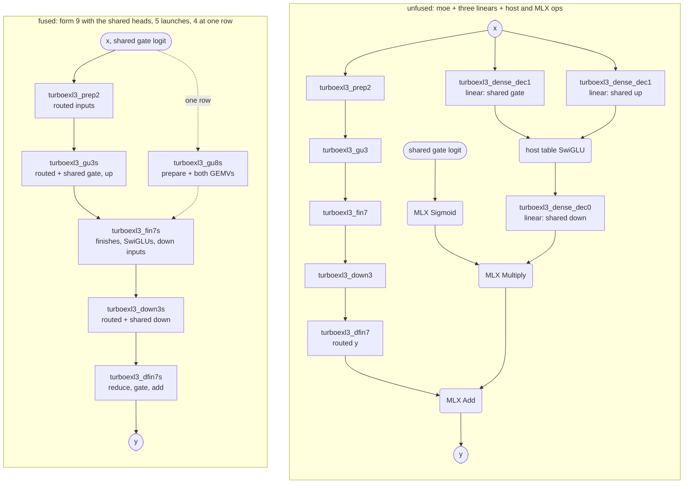
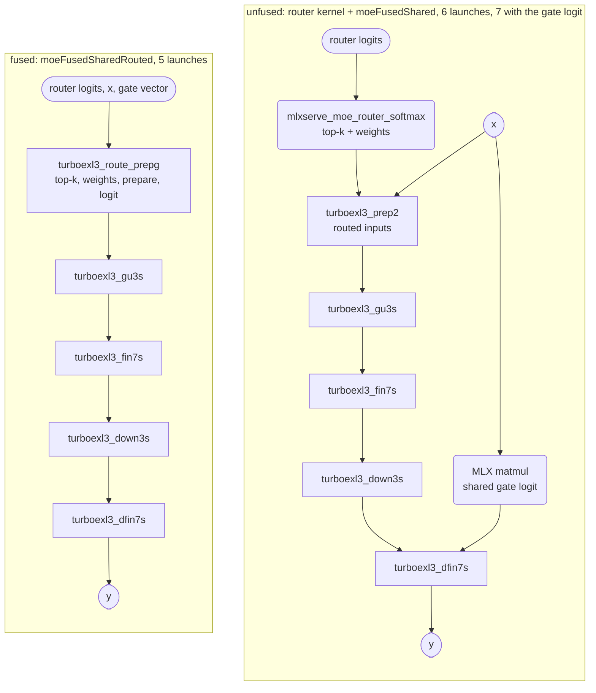
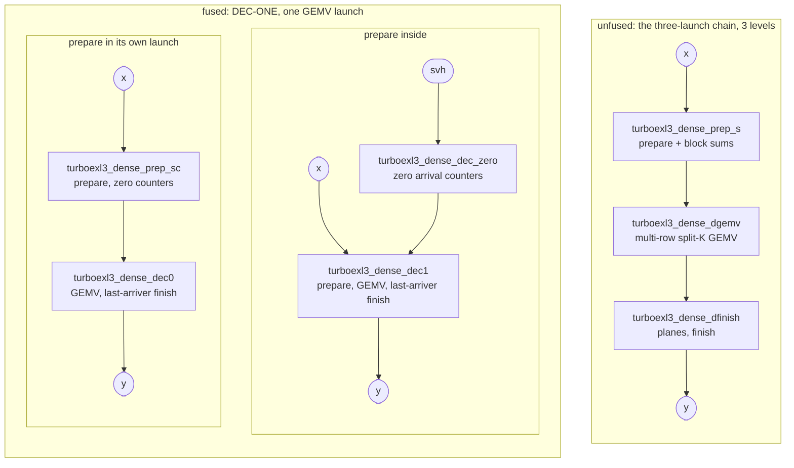
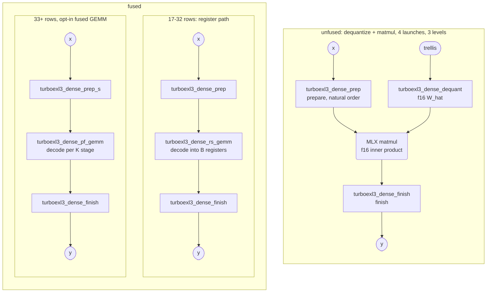
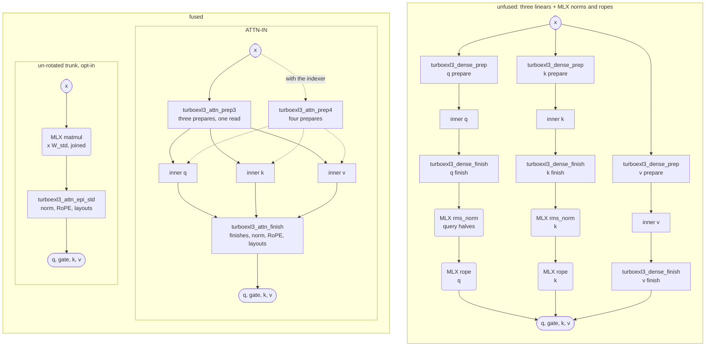
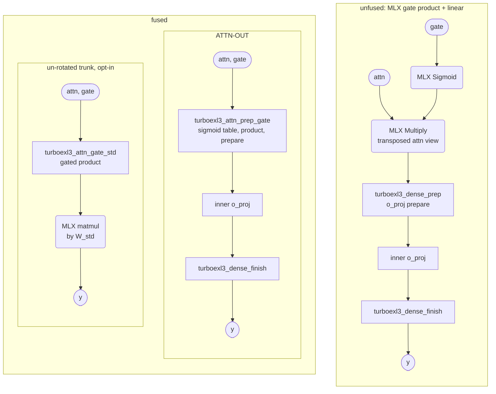
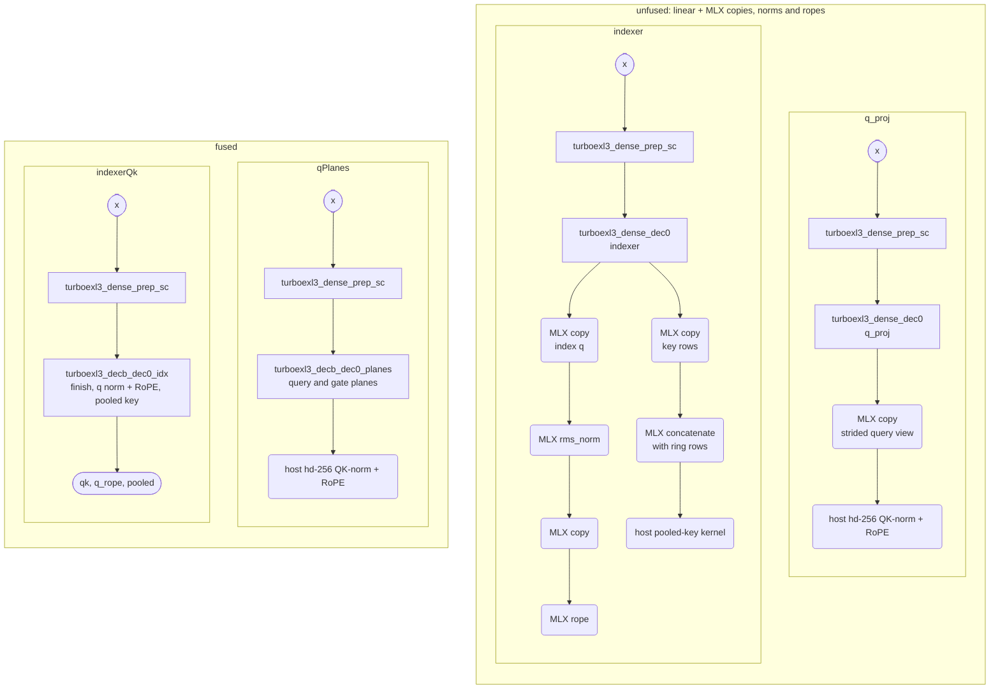

# turboexl3 kernels

This page lists every Metal kernel turboexl3 registers with MLX (the names passed to `newKernel`), the chain of launches
each fused path replaces, and how the fused path's output bits relate to that chain. The module headers (`//!`) and the
`///` comments in `src/` hold the full statements; this page is the map.

## Families

| family | entry points | rows | source |
|---|---|---|---|
| routed-expert decode GEMV | `moe` | 1–16 | `decode.zig` |
| shared expert and router in the decode launches | `moeFusedShared`, `moeFusedSharedRouted` | 1–4 (router fold: 2–4) | `decode.zig` |
| routed-expert prefill GEMM | `moe` | 17+ | `prefill.zig` |
| dense linears | `linear`, `linearSplit`, the `linear*` pieces, `trunkUnrot` | any | `dense.zig` |
| attention I/O | `attnIn`, `attnPrep4`, `linearPreparedIdx`, `linearGated`, `attnInStd`, `linearGatedStd` | 17+ | `attn_io.zig` |
| decode-row merges | `decodeMergeGated`, `decodeMergeQmergeGated`, `decodeMergeQPlanes`, `decodeMergeIndexer` | 1–16 | `decb.zig` |

## Terms

- **prepare**: `f16(H128(f16(x) · suh))` per 128-block, H128 the 128-point Hadamard scaled by 1/√128.
- **inner product**: the prepared rows times the decoded trellis, f32 accumulation, rounded to f16.
- **finish**: `f16(H128(f16(z)) · svh)`, then the output dtype.
- **`format.project`**: prepare, inner product, finish on the host. It is Sushi's EXL3 reference, ported; every kernel is
  held to it.
- **planes**: split-K partial sums, one f32 plane per K slice, summed in slice order by a finish.
- **row-slot**: one (row, top-k slot) pair of a routed call.
- **deferred MUL1 map**: a MUL1 weight is `A·t + C`, t the hashed codeword's byte sum. With the map on (the default for
  MUL1) the GEMVs and GEMMs multiply by t and the finish applies `A·acc + C·Σx` once per output. That is the exact affine
  weight, where the reference rounds each weight to f16 first. `MLX_SERVE_TURBOEXL3_DEFER=0` (routed decode),
  `MLX_SERVE_TURBOEXL3_PF_DEFER=0` (prefill) and `MLX_SERVE_TURBOEXL3_DENSE_DEFER=0` (dense) restore the per-weight f16 value.

## Exactness rule

| class | kernels | held to |
|---|---|---|
| sums in its own order | decode forms 1 and 3; the dense GEMV chain; the register-path, fused and dequantize + matmul inner products; the prefill GEMM chain | `format.project` within a tolerance (the routed chains also sum in a different order from Sushi's) |
| replaces a chain with the chain's statements | decode forms 5–9; the shared-expert heads; the router fold; DEC-ONE; the prefill options that only move work; the 128-row tiles; the resident W_hat; `linearSplit` and the `linear` pieces; ATTN-IN, ATTN-OUT and the four-member prepare; every decode-row merge | that chain's bytes |
| opt-in, its own rounding | the un-rotated bf16 trunk (`turboexl3_unrot_*` at load, then one plain matmul; the `_std` attention kernels) | the stated bars |

Tolerances are `ref.compare`'s: max |got − ref| over the reference's RMS. Byte tests compare bit patterns.

## Reading the diagrams

Each diagram puts the chain a path replaces ("unfused") beside turboexl3's launches ("fused"). Rectangles are turboexl3
launches, named by their MLX kernel name. Rounded boxes are MLX or host ops. Stadiums are tensors. Arrows are data
dependencies; an arrow implied by a longer path is left out, so the longest path is the number of dependent levels. A
dotted arrow is an alternative path.

---

## 1. Routed-expert decode GEMV (rows 1–16)

`moe` at up to `DECODE_ROWS_MAX` (16) rows runs a split-K GEMV chain. `MLX_SERVE_TURBOEXL3_DECODE_FORM` picks the form
(3, 5, 6, 7, 8 or 9; default 9). The unfused chain is `unfused.zig`'s `Steps`: per projection a prepare, a raw trellis
GEMV and a finish, then SwiGLU and the score-weighted reduce. Its kernels read the same lane plan and decoders as the
fused forms, so comparing the two measures fusion, not the reader.

| kernel | what it computes | launches it replaces |
|---|---|---|
| `turboexl3_prep2` | gate and up inputs prepared in lane order, and each 128-block's input sum | `turboexl3_prep` × 2 |
| `turboexl3_gu3` | gate and up inner products as split-K planes f32 [KS, row-slots, inter]; two row-slots that chose one expert share its decode (from two rows) | `turboexl3_gemv` × 2 |
| `turboexl3_gu8` | `prep2` and `gu3` in one launch: each threadgroup prepares its own K span in threadgroup memory | `turboexl3_prep` × 2, `turboexl3_gemv` × 2 |
| `turboexl3_fin3` | planes summed in slice order, the deferred map, the gate and up finish, SwiGLU in f32, the down input prepared and its block sums | `turboexl3_finish` × 2, `turboexl3_swiglu`, `turboexl3_prep` |
| `turboexl3_fin7` | `fin3`'s statements in `fin3`'s order with the H128s in registers (no threadgroup exchanges) | as `fin3` |
| `turboexl3_down3` | the down inner product as split-K planes | `turboexl3_gemv` |
| `turboexl3_dfin3` | per (hidden block, row): each slot's planes summed, the deferred map, the finish, an `fma` with its score in slot order; y in x's dtype | `turboexl3_finish`, `turboexl3_reduce` |
| `turboexl3_dfin7` | `dfin3` with the slots finished side by side (one simdgroup each), then the same score chain | as `dfin3` |
| `turboexl3_gu5` | form 5: an expert group's inputs (up to 4 row-slots) prepared in threadgroup memory, then `gu3`'s GEMV for every member from one decode | `turboexl3_prep` × 2, `turboexl3_gemv` × 2 |
| `turboexl3_dn5` | form 5: `fin3`'s mid for every member, the down GEMV in `down3`'s partition, each slot finished up to its score (f16) | `turboexl3_finish` × 3, `turboexl3_swiglu`, `turboexl3_prep`, `turboexl3_gemv` |
| `turboexl3_red5` | form 5: the score `fma` chain in slot order | `turboexl3_reduce` |
| `turboexl3_dn6` | form 6: `dn5`, then the slot that arrives last at its (row, hidden block) runs `red5`'s chain (an integer arrival counter) | as `dn5`, plus `turboexl3_reduce` |
| `turboexl3_gu` | form 1: inputs prepared in threadgroup memory, the gate and up GEMV, finish and SwiGLU; h in f32 | `turboexl3_prep` × 2, `turboexl3_gemv` × 2, `turboexl3_finish` × 2, `turboexl3_swiglu` |
| `turboexl3_down` | form 1: per (hidden block, row), each slot's down prepare, GEMV, finish and score `fma` in slot order | `turboexl3_prep`, `turboexl3_gemv`, `turboexl3_finish`, `turboexl3_reduce` |
| `turboexl3_gu4`, `turboexl3_down4` | form 1b: `gu` and `down` over rows prepared by `turboexl3_prep` | as `gu` and `down`, less the prepares |
| `turboexl3_gu2`, `turboexl3_down2`, `turboexl3_reduce2` | form 2: per-row-slot GEMV and finish (SwiGLU in `gu2`, the score in `down2`), the slot sum in `reduce2` | `turboexl3_gemv` + `turboexl3_finish` (+ `turboexl3_swiglu`); `turboexl3_reduce` |
| `turboexl3_prep`, `turboexl3_gemv`, `turboexl3_finish`, `turboexl3_swiglu`, `turboexl3_reduce` | the unfused steps; `turboexl3_prep` also feeds forms 1b and 2 | — |

| form | launches | levels | kernels | bytes |
|---|---|---|---|---|
| unfused (`unfused.Steps`) | 11 | 8 | `prep` × 2, `gemv` × 2, `finish` × 2, `swiglu`, `prep`, `gemv`, `finish`, `reduce` | form 1's arithmetic as separate steps; no test runs it |
| 1 (`Kernels`) | 2 | 2 | `gu` → `down` | its own order |
| 1b (`Kernels4`) | 5 | 4 | `prep` × 2 → `gu4` → `prep` → `down4` | its own order; not reachable from `moe`, no test |
| 2 (`Kernels2`) | 6 | 5 | `prep` × 2 → `gu2` → `prep` → `down2` → `reduce2` | its own order; not reachable from `moe`, no test |
| 3 | 5 | 5 | `prep2` → `gu3` → `fin3` → `down3` → `dfin3` | its own split-K order: the bytes forms 5–9 keep |
| 5 | 3 | 3 | `gu5` → `dn5` → `red5` | form 3's |
| 6 | 2 | 2 | `gu5` → `dn6` | form 3's |
| 7 | 5 | 5 | `prep2` → `gu3` → `fin7` → `down3` → `dfin7` | form 3's |
| 8 | 4 | 4 | `gu8` → `fin7` → `down3` → `dfin7` (form 7 where `gu8` is not admitted) | form 3's |
| **9 (served)** | 4 at one row, 5 from two | 4 / 5 | one row: `gu8` → `fin7` → `down3` → `dfin7`; 2–16 rows: `prep2` → `gu3` → `fin7` → `down3` → `dfin7` | form 3's |

`gu8` is admitted when a threadgroup's K span is 128-aligned (`gu8Admitted`). Form 9 uses it up to `gu8_rows` (1) rows,
since it re-rotates its span in every output-tile threadgroup. Form 9 has its own launch shape (`bt1`, `bt9`, `kdiv9`:
output tiles and K slices per threadgroup), which changes no sum.

**Exactness.**
- Forms 1 and 3 round where `format.project` rounds but sum in their own order. Form 1 splits K four ways per
  threadgroup. Form 3 splits K into a partition fixed per geometry (gate and up: KS slices × 2 parts; down: KS2 × 4
  parts) and sums the planes in slice order; with MUL1 it also applies the deferred map. Held by tolerance: form 1 within
  5e-3 of the reference's RMS in f32 (rates n 32–128, MUL1 and MCG, a 12-bit window); `root.moe` (form 9, bf16 x and y)
  within 1.5e-2.
- A form-3 row's bytes do not depend on how many rows share the call: the K partition is the geometry's alone, and the
  row count only sets how many threadgroups share a row-slot's slices. The GPU test runs each row alone against rows
  2–16 together, with expert-grouped row-slots and both MUL1 decodes.
- Forms 5–9 are byte-identical to form 3. They keep its K partition, its per-lane FMA order (input tiles in order,
  weights m = 0..7), its quad folds and part sums and its rounding points. Only the launch shape moves: tiles and slices
  per threadgroup, expert groups, where the prepare runs, whether the H128 runs in registers or through threadgroup
  memory. The GPU tests compare bits at rows 1–5, 8 and 16 over several tile, K-divisor and grouping settings and both
  MUL1 decodes, in f32 (forms 5 and 6) and in f32 and bf16 (forms 7–9).

## 2. Shared expert and router inside the decode launches (rows 1–4)

`moeFusedShared` computes `y = routed + sigmoid(logit) · shared(x)` for a gated shared expert whose gate, up and down are
dense EXL3 linears. The shared expert has no launch of its own: its GEMVs ride form 9's gate+up and down launches as
extra grid rows, and its finishes ride the finish launches (`fin7s`, `dfin7s`). Each `linear` on the unfused side is
drawn as its DEC-ONE GEMV launch; its counter-zeroing or prepare launch is left out.

`moeFusedSharedRouted` also folds the host's softmax router (and, with `gate_vec`, the shared gate's logit) into the
prepare launch. It serves the rows whose prepare is a launch of its own, 2–4 by default: at one row the prepare rides
`gu8s`, so there is no prepare launch to fold into.

| kernel | what it computes | launches it replaces |
|---|---|---|
| `turboexl3_gu3s` | `gu3` plus grid rows for the shared gate and up: each K slice (one 128-block of hidden) prepared in-kernel (dense `prep_s`) and run as dense `dgemv`'s slice | the shared gate and up `linear`s' prepare and GEMV |
| `turboexl3_gu8s` | `gu8` plus the same head (one row) | as `gu3s`, plus `turboexl3_prep2` |
| `turboexl3_fin7s` | `fin7` plus the shared rows: dense `dfinish` of gate and up, the host's table SwiGLU, dense `prep_s` of the product | the gate and up finishes, the SwiGLU kernel, the down `linear`'s prepare |
| `turboexl3_down3s` | `down3` plus the shared down GEMV's slices | the down `linear`'s GEMV |
| `turboexl3_dfin7s` | `dfin7`, the shared down's `dfinish` in one more simdgroup, then the routed y in the output dtype + sigmoid(logit) (MLX's, by table) × down | the down finish, MLX Sigmoid, Multiply, Add |
| `turboexl3_route_prep` | the router's selection, softmax and renormalized weights, then `prep2`, one threadgroup per (hidden block, row) | `mlxserve_moe_router_softmax`, `turboexl3_prep2` |
| `turboexl3_route_prepg` | `route_prep` plus the shared gate's logit in MLX's bf16 gemv order | as `route_prep`, plus the logit's MLX matmul |
| `turboexl3_sgu`, `turboexl3_sfin`, `turboexl3_sdown` | the three heads in launches of their own beside form 9's (`moeSharedSide`) | test arm, same bytes |
| `turboexl3_gu8t`, `turboexl3_gu3t`, `turboexl3_gu3p`, `turboexl3_prep2t`, `turboexl3_fin7t`, `turboexl3_down3t`, `turboexl3_dfin7t` | v2 heads inside form 9's launches: one simdgroup per (K slice, output tiles), no threadgroup reduction (`moeShared2`) | test arm, same bytes |
| `turboexl3_sgu2`, `turboexl3_sgu2p`, `turboexl3_sprep2`, `turboexl3_sfin2`, `turboexl3_sdown2` | the v2 heads beside form 9's launches (`moeSharedSide2`) | test arm, same bytes |

`moeFusedShared` serves up to `shared_rows_max` (4) rows when the shared intermediate is the routed width, each gate and
up K slice is one 128-block of hidden, the down split is whole 4-part slices and the output is bf16 or f16. The routed fold
also needs k ≤ 31 and at most 2048 experts; with the gate vector, bf16 at 2–4 rows, D > 64 and D ≥ 16 · rows (the shapes
at which MLX's matmul runs that gemv). Anything else is refused before any launch.

**Exactness.**
- `moeFusedShared` gives the host chain's bytes: form 3's routed y, the three `linear`s, the host's table SwiGLU and MLX's
  Sigmoid, Multiply and Add. The heads run dense.zig's decode statements (`prep_s`, `dgemv`, `dfinish`) on the shared
  expert's own K split (`Dense.ksFor`) and MUL1 deferral, every slice exactly as a threadgroup of its own computes it, so
  K slices per threadgroup (`MLX_SERVE_TURBOEXL3_SHARED_SPT`) are launch shape only. The SwiGLU and the gate tail repeat
  the host's statements in the output dtype. The GPU test covers rows 1–4, both routed MUL1 decodes, form 9's tiles 1
  and 2, three slices-per-threadgroup settings, and the side and v2 variants under every launch-shape knob.
- `moeFusedSharedRouted` gives the router kernel's and `moeFusedShared`'s bytes. `turboexl3_route_prep` is built from
  verbatim slices of the router's text (softmax mode: selection, softmax tree, renormalized weights) and of `prep2`'s body,
  each run on the same lanes. The gate logit repeats MLX's `gemv_bfloat16_bm1_bn8_sm1_sn32_tm{1,4}_tn4` column order and
  fold. The GPU test compares the launch's outputs with the router kernel + `prep2` (512 experts, rows 1–4, 8 and 16, bf16
  and f16 logits, exact ties), the logit with MLX's matmul, and the whole call with router + `moeShared` at rows 2–4.

## 3. Routed-expert prefill GEMM (rows 17+)

The chain routes the slots by expert, prepares the gate and up inputs in sorted order, runs one GEMM launch for gate and
up, a mid launch, the down GEMM, and a finish that sums each row's slots in slot order. The trellis is decoded inside the
GEMM's weight loader: per 64-deep K stage each simdgroup decodes its share of the stage's 16 trellis tiles into
threadgroup memory, and the NAX matrix units multiply 64 or 128 rows by it with f32 accumulation. No f16 W_hat reaches
device memory; dequantize + matmul (section 4) is the unfused shape of one such GEMM. This repository has no unfused
routed prefill chain and does not hold Sushi's, so the left side is the base option set (`prefill.Options{}`) and the
right the served set (`root.pfOptions`).

The base chain already fuses: the decode sits in the GEMM's loader, gate and up share one GEMM launch, `mid` merges the
gate and up finishes, SwiGLU and the down prepare, and `fin` merges the down finish and the slot sum. The served set
adds: 64-row tiles with the register path for remainders of ≤ 32 rows in the same launch (`small = .mixed`), a
double-buffered weight stage in NAX fragment order with unrolled MMA sub-steps, the integer-rate reader where
n % 16 == 0 (in the register path too: `sintr`), the deferred MUL1 map, four output blocks per down threadgroup (`ncb`),
the one-launch route (`froute`), A layout 2, and the 128-row tiles (`t128`). With `froute` and without `t128` the chain
is 6 launches in 6 levels. `MLX_SERVE_TURBOEXL3_PREFILL=0` hands prefill rows back to the host. The third column below
is relative to the base chain.

| kernel | what it computes | launches it replaces |
|---|---|---|
| `turboexl3_pf_table`, `turboexl3_pf_table_m` | after MLX's argsort: each expert's run by binary search, an exclusive scan, the tile table (`_m`: remainders of ≤ 32 rows as register-path tiles) | — |
| `turboexl3_pf_froute`, `turboexl3_pf_froute_m` | each expert's slots counted (threadgroup atomics), scanned and scattered: `order` and the tile table in one launch | MLX argsort, the table |
| `turboexl3_pf_t128_route` | `froute`'s count and scatter, 128-row tiles for each expert's full runs (and a remainder of more than `t128_cut`, 64, rows), the mixed table over the rest, each expert's first remainder position | MLX argsort, the table |
| `turboexl3_pf_prep` | the gate and up inputs prepared in sorted order (A layout per `alay`), `inv`, the block sums | — |
| `turboexl3_pf_gemm2`, `turboexl3_pf_gemm1` | the gate + up GEMM (two ops) and the down GEMM, shared-decode body: the weight stage decoded into threadgroup memory, NAX MMA; `bk128` and `ncb` reshape the down launch | — |
| `turboexl3_pf_gemm2s`, `turboexl3_pf_gemm1s` | the register-path body (`small = .all`): every tile ≤ 32 rows; each simdgroup an independent 32 × 32 item that decodes straight into its B fragment registers, no threadgroup memory | `_gemm2` (`_gemm1`) |
| `turboexl3_pf_gemm2m`, `turboexl3_pf_gemm1m` | the mixed launch: the table's large tiles through the shared-decode body, its ≤ 32-row tiles through the register path | `_gemm2` and `_gemm2s` (`_gemm1` and `_gemm1s`) as one launch |
| `turboexl3_pf_t128_gum`, `turboexl3_pf_t128_dnm` | the mixed launch over the remainder table | `_gemm2m` (`_gemm1m`), with `_gut` (`_dnt`) beside it |
| `turboexl3_pf_t128_gut`, `turboexl3_pf_t128_dnt` | the shared-decode body at 128 rows over the 128-row tiles, beside the mixed launch; each launch writes its own output | as above |
| `turboexl3_pf_mid`, `turboexl3_pf_t128_mid` | gate and up finish, SwiGLU in f32, the down input prepared and its block sums (`t128`: each row from the launch that computed it) | — |
| `turboexl3_pf_fin`, `turboexl3_pf_t128_fin` | the down finish and the score-weighted slot sum in slot order, through `inv` (`t128`: each row from the launch that computed it) | — |
| `turboexl3_pf_prep_v`, `turboexl3_pf_mid_v`, `turboexl3_pf_fin_v` | `aux`: prep, mid and finish with four consecutive elements per lane and several simdgroups per threadgroup | `_prep`, `_mid`, `_fin` |

Suffixes: `s` the register path alone, `m` mixed (both bodies in one launch), `v` the vector-layout prep, mid and
finish. A layouts (`alay`): 0 natural order; 1 each 32-element block in the A fragments' slot order (one 16-byte load per
fragment row and 32-deep step); 2 each 16-element block (one 8-byte load per fragment row and 16-deep slice; served).
`half_rows` lets a simdgroup whose rows end within its first 16 multiply only its first fragment row.

**Exactness.**
- Rounding points are `format.project`'s. The GEMMs sum in the NAX's order (16-deep MMAs, K ascending) and apply the
  deferred map, so the chain is held by tolerance: f32 y within 5e-3 of the reference's RMS on sampled rows; bf16 y
  within 1.5 × Sushi's prefill arm's own error + 2e-3 where the host exports Sushi.
- Options that only move loads, MMAs or work give the bytes of the same set without them: `bk128`, `ncb`, `sintr`,
  `froute`, `aux` (block sums in the strided order), `alay`, `half_rows` (GPU test, byte for byte). `moeT128` gives
  `moe`'s bytes, call and stage by stage: bm 128 and bm 64 run the same per-simdgroup K loop.
- A row's bytes do not depend on where its slots land in the sorted order or the tiles, so `froute`'s arrival-order
  scatter changes no output. `aux_lane_sums` (off) sums the block sums in the lane's order; its outputs may differ in
  the last bits.

## 4. Dense linears

`linear` picks a path by row count (`Dense.pathFor`):

| rows | path | launches |
|---|---|---|
| 1–4 (`MLX_SERVE_DEC_ONE_ROWS`) | DEC-ONE: one GEMV launch; the threadgroup that arrives last at its (output block, row chunk) runs the finish. The prepare runs inside it at 1 row (`MLX_SERVE_DEC_ONE_PREP`) or up to 1024 outputs (`MLX_SERVE_DEC_ONE_PREP_OUT`) where its buffer fits, else in `prep_sc`'s launch | 2 |
| 5–16, or DEC-ONE off | `prep_s` → multi-row `dgemv` → `dfinish` | 3 |
| 17–32 (`small_rows`) | `prep` → register-path GEMM `rs_gemm` → `finish` | 3 |
| 33+ | `prep` → `dequant` + MLX matmul → `finish` (resident W_hat: no `dequant` after the first call; un-rotated: one MLX matmul) | 4 (3; 1) |
| 33+, `MLX_SERVE_TURBOEXL3_DENSE_PREFILL=fused` | `prep_s` → `pf_gemm` → `finish` | 3 |

`dec_zero` reads only svh, a weight, so it waits on nothing and runs beside the previous op.

| kernel | what it computes | launches it replaces |
|---|---|---|
| `turboexl3_dense_prep_s` | the prepare in lane order and each 128-block's input sum | — |
| `turboexl3_dense_dgemv` | multi-row GEMV: each weight decoded once per threadgroup for up to 4 rows (`MLX_SERVE_TURBOEXL3_DENSE_RB`), split-K planes over a K split fixed per shape (`ksFor`) | the row-slot GEMV, one decode per row |
| `turboexl3_dense_dfinish` | planes summed in slice order, the deferred map, the finish, the output dtype | — |
| `turboexl3_dense_dec1` | DEC-ONE: the threadgroup's K slice prepared in threadgroup memory, `dgemv`'s planes, `dfinish` in the last-arriving threadgroup (an integer counter) | `prep_s`, `dgemv`, `dfinish` |
| `turboexl3_dense_dec0` | DEC-ONE over `prep_sc`'s rows | `dgemv`, `dfinish` |
| `turboexl3_dense_prep_sc` | `prep_s` plus zeroing DEC-ONE's arrival counters | `prep_s` |
| `turboexl3_dense_dec_zero` | zeroes the counters for `dec1` | — |
| `turboexl3_dense_prep` | the prepare without block sums: natural order (register path, matmul) or lane order (row-slot arm) | — |
| `turboexl3_dense_gemv` | the row-slot GEMV (`unfused.text_gemv`; `MLX_SERVE_TURBOEXL3_DENSE=rowslot`, an A/B arm): every row decodes the trellis again | — |
| `turboexl3_dense_finish` | the finish of an f32 or f16 inner product, the output dtype | — |
| `turboexl3_dense_rs_gemm` | 17–32 rows: the routed register-path GEMM with one op, 32-row tiles, the trellis decoded straight into the B fragment registers (f16 weight values), f32 accumulation, f16 out | `turboexl3_dense_dequant`, MLX matmul |
| `turboexl3_dense_dequant` | the f16 W_hat [in, out] from the trellis | — |
| `turboexl3_dense_pf_gemm` | opt-in: the routed shared-decode GEMM over 64-row tiles of the one "expert", with the deferred map | `turboexl3_dense_dequant`, MLX matmul |
| `turboexl3_dense_finish_pieces` | one finish over a call split into 2–4 row pieces (the host's GDN overlap) | — |
| `turboexl3_unrot_cols` | at load: the ±1 H128 along each row's 128-column blocks of W_hat, into f32 | — |
| `turboexl3_unrot_rows` | at load: the ±1 H128 along each column's 128-row blocks, × 1/128 × suh × svh, one rounding to bf16 or f16: `W_std = diag(suh) H W_hat H diag(svh)` | per call: `prep`, `dequant`, MLX matmul, `finish` |

The pieces `linearInnerSplit`, `linearPrepared`, `linearFinish` and `linearPrep` (around the host's fused GDN
norm-gate) and `linearPiecesBegin`, `linearPieceInner`, `linearPiecePrepared` and `linearPiecesFinish` (row pieces) are
`linear`'s own launches with `linear`'s configs, split where the host interleaves its own. `trunkUnrot` joins up to 4
linears that read one x (an MLX concatenate) into one W_std whose members are column views, and keeps a group rotated
when its W_std is not finite.

**Exactness.**
- The multi-row GEMV chain sums in its own order (K slices fixed per shape, four parts per slice, planes in slice order)
  and applies the deferred map. Held to `format.project` per row: within 5e-3 with f32 x and y on the trunk's shapes at
  GEMV (1–16), register-path (17, 31, 32) and prefill (40, 129, 200) rows; within 2.5e-2 with bf16 x and y (4 and 40
  rows). A row's bytes are the same alone and among 2–16 rows.
- DEC-ONE gives the three-launch chain's bytes. Its value-setting lines are `dgemv`'s, `prep_s`'s and `dfinish`'s (a CPU
  test holds them equal), and the planes are still summed in slice order; the arrival is an integer counter, with no
  float atomics. The GPU test covers the trunk's shapes, rows 1–4 and 8, both prepare placements, the MUL1 deferral on
  and off, bf16 and f32, one MCG shape, and each row alone.
- The register path, the fused GEMM and MLX's matmul sum in their own MMA orders: held to `format.project` by the same
  bars (the fused GEMM with its switch set).
- `linearSplit` records the same launches on two streams: `linear`'s bytes (GPU test at 8192, 1328 and 40 rows on both
  inner products). The row pieces give `linear`'s bytes of the concatenated rows wherever MLX's matmul runs the whole
  call's kernel at every piece's row count (the caller's check).
- The resident W_hat is the per-call `dequant`'s output, kept: each weight comes from its own tile with no reduction,
  and W_hat is only read. Every call gives the per-call path's bytes (GPU test: every trunk linear kind at 33–8703 rows,
  both streams, ATTN-IN and ATTN-OUT).
- The un-rotated trunk is a different rounding of the same linear map: W_std rounds once per weight to the activation
  dtype and x·W_std once per output, where the chain rounds x's rotated copy, the inner product and the finish to f16.
  Bars: W_std within one bf16 step of an f64 reference (half a step plus 16 f32 eps of its terms where they cancel), at
  most 1 element in 1000 off that reference's bf16 rounding; a call's y within rel RMS 2^-7.5 and max |diff| 2 bf16
  steps of max |chain|'s binade. Calls of up to 32 rows never read the table and keep the trellis paths' bytes.

## 5. Attention I/O (rows 17+)

ATTN-IN (`attnIn`) computes q (each head [query | gate]), k and v of one x, with the QK RMSNorm and partial RoPE in the
finish. ATTN-OUT (`linearGated`) computes o_proj over `T(attn · sigmoid(gate))`, the product formed inside the prepare.
"inner" below is `linear`'s inner product at these rows: `turboexl3_dense_rs_gemm` (17–32 rows) or
`turboexl3_dense_dequant` + MLX matmul (33+). The GEMV rows and the fused-GEMM option are refused; the host keeps its
chain there.

| kernel | what it computes | launches it replaces |
|---|---|---|
| `turboexl3_attn_prep3` | q's, k's and v's prepared copies from one read of x, natural order | `turboexl3_dense_prep` × 3 |
| `turboexl3_attn_prep4` | the same with the QSA indexer projection as a fourth member (`attnPrep4`; the indexer then runs `linearPreparedIdx`) | `turboexl3_dense_prep` × 4 |
| `turboexl3_attn_finish` | per 256-column unit: the members' finishes, then RMSNorm and the NeoX rotation of the q and k heads; q, k, v head-major [1, H, S, 256], the gate [1, S, H, 256] | `turboexl3_dense_finish` × 3, MLX rms_norm × 2, MLX rope × 2 |
| `turboexl3_attn_prep_gate` | `T(attn · sigmoid(gate))` (MLX's sigmoid by table, the product in T), then o_proj's prepare | MLX Sigmoid, MLX Multiply, `turboexl3_dense_prep` |
| `turboexl3_attn_epi_std` | `attn_finish`'s epilogue, verbatim, over standard-basis products (one joined product or each member's own) | `turboexl3_attn_prep3`, three inner products, `turboexl3_attn_finish` |
| `turboexl3_attn_gate_std` | the gated product alone, for one MLX matmul by o_proj's W_std | `turboexl3_attn_prep_gate`, the inner product, `turboexl3_dense_finish` |

**Exactness.**
- ATTN-IN and ATTN-OUT give the host chain's bytes. Each member's prepare is dense `text_prep`'s statements on the same
  f16 value of x, and the inner products are `linear`'s own launches. The finish runs `text_finish`'s statements per
  128-block, then MLX's `rms_single_row` order at axis 256 (f32 squares in index order, two simd sums,
  `precise::rsqrt`) and the rotation against angle rows that MLX's own rope produced. These are the statements of the
  host's hd-256 QK-norm+RoPE kernel (`QK_NORM_ROPE_256_SOURCE`), which its own test pins to the composed MLX chain.
  ATTN-OUT's product is MLX's Sigmoid by table and Multiply in T, exact in f32 before its one rounding. The GPU test
  covers 17, 31, 32, 33, 1328 and 8192 rows, two rate sets, and both gate layouts; the four-member prepare is checked
  against each member's own prepare and the indexer's `linear`.
- The `_std` kernels repeat the epilogue and the gate product verbatim, but their inputs are un-rotated products, so
  their outputs are held to the un-rotated bars (section 4) against `attnIn` and `linearGated`.

## 6. Decode-row merges (rows 1–16)

At the GEMV rows of a gated, QK-normed attention layer, four entries merge the host's neighboring launches into the
dense linear's own. Each gives its chain's bytes whether DEC-ONE takes the call or not. The unfused `linear`s are drawn
in DEC-ONE's own-prepare arm (`prep_sc` → `dec0`).

| kernel | what it computes | launches it replaces |
|---|---|---|
| `turboexl3_decb_prep_gate` | the host strided gate kernel's statement, then `prep_sc`'s (lane order, block sums, DEC-ONE's counters) | the strided gate kernel, `linear`'s prepare (`prep_sc` or `prep_s`) |
| `turboexl3_decb_merge_gate` | the QSA core's split-K merge (`msv_attn_qsa256_qmerge`'s statements and its T rounding), the gate product, o_proj's prepare | `msv_attn_qsa256_qmerge`, the strided gate kernel, `linear`'s prepare |
| `turboexl3_decb_dec0_planes`, `turboexl3_decb_dec1_planes`, `turboexl3_decb_dfinish_planes` | q_proj's DEC-ONE finish (`dec0`, `dec1`) or chain finish (`dfinish`) storing each head's query and gate halves as two contiguous planes | the row-contiguous copy of the strided query view |
| `turboexl3_decb_dec0_idx`, `turboexl3_decb_dec1_idx`, `turboexl3_decb_dfinish_idx` | the indexer projection's finish, then each index query head's norm and rotation (the host's hd-128 `QK_NORM_ROPE_SOURCE` statements) and the one pooled block key the call completes (`QSA_POOL_ROPE_SOURCE`'s statements) | the index-q copy, rms_norm, copy and rope; the pooled-key copy, concatenate and kernel |

`gatedDecode` saves one dependent level where `linear` prepares in a launch of its own (`prep_sc` → `dec0`, or the
three-launch chain), and one launch where DEC-ONE prepares inside `dec1`. `mergeGatedDecode` saves one level more: the
merge launch. The `dec1_*` and `dfinish_*` variants run when DEC-ONE prepares inside its launch (beside `dec_zero`) or
is off (after `prep_s` and `dgemv`).

**Exactness.** Byte-identical to the host's chains at every rounding point. The value-setting statements are dense's or
the host's (the strided gate kernel, `msv_attn_qsa256_qmerge`, `QK_NORM_ROPE_SOURCE`, `QSA_POOL_ROPE_SOURCE`), spliced
or copied verbatim, and CPU tests pin the texts. The GPU tests compare bits at rows 1, 2, 3, 4, 8 and 16 (the indexer
also with 0–3 ring rows) in three arms: DEC-ONE off, on with the prepare inside, on with the prepare in its own launch.
The pooled key needs the block's rows in DEC-ONE's first row chunk; other calls are refused.

## 7. Building blocks

- **`lane.zig`, the codeword readers.** Lane L of a simdgroup owns code positions 8L..8L+7 of a 256-weight tile (the
  tensor-core order). Its eight codewords lie in at most four consecutive 32-bit words of the tile's circular bitstream.
  The readers: the general four-word funnel (`exl3_lane_words`, `exl3_lane_cw`); the integer-rate fast path (`IntPlan`,
  n % 16 == 0: one select, one shift, one mask per weight); the general fast path (`GenPlan`, every even n); and
  `exl3_tile_load` / `exl3_tile_cw`, which under `EXL3_R64` (default 1) read one 64-bit window (n ≤ 108) or a 96-bit
  window as three words (n ≤ 128), rebuilding the lane's start bit from the same plan. The host mirrors of the lane plan
  and of both fast paths are held to `format.unpackTile` at every even n in [16, 128] (the integer path at K1–K8).
  Decoders: `exl3_decode<CB>` (MUL1 and MCG, masked to the window), and `exl3_mul1_t` / `exl3_mul1_th` (MUL1's byte sum
  t for the deferred map; `EXL3_T1V` picks one of four exact routes). `EXL3_KU` loads input tiles in pairs and keeps the
  sums.
- **Shared Metal headers.** `decode.header` is the lane helpers, `turboexl3_row_of` and the GEMV core
  (`turboexl3_members`, `turboexl3_gemv_members`, `turboexl3_fold`, `turboexl3_h128`). `header5` adds form 5's helpers
  (`turboexl3_group`, `turboexl3_gemv_tg`, `turboexl3_h128r`, ...), `header_s` the shared heads' (`turboexl3_sdgemv`,
  `turboexl3_sprep`, `turboexl3_sfinish`), `header_t` the v2 heads'. The prefill prep, mid and finish read
  `header_small` (an H128 helper on `decode.header`); the GEMMs read `header_nax` and `header_nax_small` (the NAX tiles,
  the decoders and the bodies' helpers).
- **`steel_nax.metal`.** MLX 0.32.2's steel headers inlined: `steel/defines.h`, `steel/utils/type_traits.h`,
  `steel/utils/integral_constant.h` and `steel/gemm/nax.h`, each section marked with its path and copyright line, under
  MIT (see NOTICE). The prefill and dense GEMMs build on its `NAXTile` and `tile_matmad_nax` (over
  `mpp::tensor_ops::matmul2d`).
- **`format.zig`, the reference.** Rates (even n in [16, 128]), windows (8–16 bits), the MUL1 and MCG codebooks,
  `tensorCorePerm`, `unpackTile`, `hadamard128`, `prepareInput` → `innerGemv` → `finishOutput` (`project`),
  `reconstructPublic`, and a packer for tests. Ported from Sushi's `src/exl3/expert_exl3.zig` with its pins.
- **`ref.zig`.** `moeRowDec` (Sushi's `moeSwigluHost` over `format.project`: gate and up projected, SwiGLU in f32, down
  projected, the score-weighted sum in slot order), `synthBank` (random trellis halfwords, scales that keep outputs
  O(1)), and `compare`.
- **Not kernels of the library.** `turboexl3_test_host_swiglu`, `turboexl3_test_router` and `turboexl3_test_qmerge` run
  the host's SwiGLU, router and merge texts as test references. `TURBOEXL3_METAL_DUMP=1` prints every kernel as a
  standalone translation unit for an offline `xcrun metal` compile; the dump's unit names (`turboexl3_pf_gemm2s_j`,
  ...) label option variants and are not MLX kernel names.
