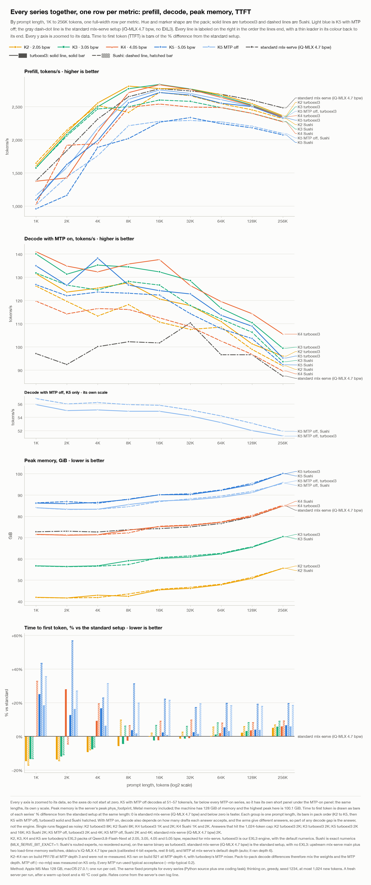
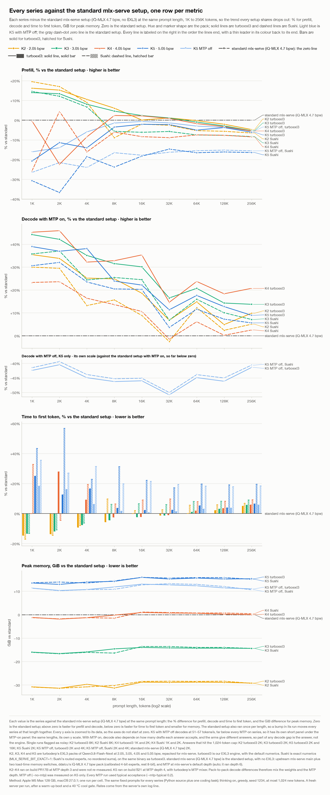
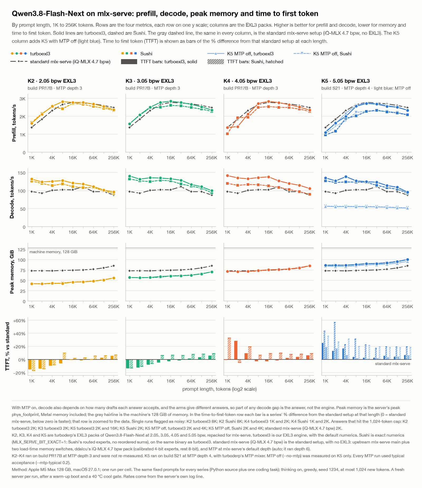

# Results

Measured with mlx-serve on one Apple M5 Max (128 GB, macOS 27.0.1), serving [Qwen3.8-Flash-Next](GLOSSARY.md#qwen38)
from the MLX repacks of [turboderp](GLOSSARY.md#turboderp)'s packs (the table in [the README](../README.md#the-packs)).
The context-length tables for K2 to K5 were also in the description of
[ddalcu/mlx-serve#997](https://github.com/ddalcu/mlx-serve/pull/997). The code that served them is the branch
[`qwen38-exl3-full`](https://github.com/davidtai/mlx-serve/tree/qwen38-exl3-full) of davidtai/mlx-serve, which serves
these packs through turboexl3's [quant plugin](GLOSSARY.md#quant-plugin).

## Quality: KL divergence and perplexity (turboderp's)

The quality of the weights themselves, as turboderp measured it with exllamav3 on his files, before the MLX repack (the
repacks hold the same files; these numbers were not measured through mlx-serve). Mean KL divergence D_KL(p_BF16 ‖ p_quant)
and perplexity over a self-generated in-domain trace (14,496 input and 45,588 output tokens); BF16 has a perplexity of
1.38474 on it, and the KLD noise floor is 0.00262. From [his model card](https://huggingface.co/turboderp/Qwen3.8-Flash-Next-exl3):

| pack | turboderp's branch | KLD vs BF16 | perplexity |
|---|---|---:|---:|
| K2 | 2.05bpw_h4_ng4 | 0.0681 | 1.4871 |
| K3 | 3.05bpw_h5_ng5 | 0.0174 | 1.4074 |
| K4 | 4.05bpw_h6_ng6 | 0.0066 | 1.3897 |
| K5 | 5.05bpw_h6_ng6 | 0.0040 | 1.3848 |

His charts (the EXL3 series is his plain quants, whose 2.05 to 5.05 points are K2 to K5; EXL3-SC are his self-calibrated
quants; GGUF, GSQ-RCO and NVFP4 are other formats on the same trace):

The end-to-end check through mlx-serve is the [coding evals](#coding-evals) below.

## Charts

Prefill, decode, peak memory and time to first token from 1K to 256K, every pack and arm in one row per metric, with
the standard mlx-serve setup (the iQ-MLX 4.7 bpw pack) among them; time to first token is drawn as each series' %
difference from that setup. Each chart carries its method in its caption and is drawn from the tables below.

Every series as its difference from the standard setup at each length (0 = standard mlx-serve):

The same data with one column per pack, the standard setup as the reference line in each:

Each metric at full width, every series: [prefill](charts/all_prefill.png), [decode](charts/all_decode.png),
[peak memory](charts/all_peak_memory.png), [time to first token, in seconds at each length](charts/all_ttft.png).

- [Wall time and answer length](charts/wall_time.png)
- [MTP acceptance: per-draft hit rate and drafts accepted per round](charts/mtp_acceptance.png)
- [K5 with MTP off](charts/mtp_off_k5.png)
- [turboexl3 against Sushi, percent difference](charts/turbo_vs_sushi.png)
- [K5 against the standard setup](charts/vs_standard.png)
- [Coding evals](charts/coding_evals.png)

## Across context lengths

One run per cell. Each prompt is the same fixed text (Python source with one coding task) for every pack and arm, sent as
one user message in Qwen's chat template with thinking on, greedy, seed 1234, at most 1,024 new tokens. Each run gets a
fresh server after a warm-up boot on the same prompt and a 40 °C cool gate. Server flags: `--ctx-size 262144
--max-concurrent 1 --prefix-cache-mem 1GB` and the MTP flags below, with `MLX_SERVE_NOCACHE_LOAD=1 MLX_SERVE_NGRAM_WARM=0
MLX_SERVE_GPU_CEILING_MB=114688 MLX_SERVE_CACHE_LIMIT=2147483648`. The rates come from the server's own request line.

- **K2 to K5** are the 2.05, 3.05, 4.05 and 5.05 packs, run on mlx-serve's tree from before its rewrite (PR 978) with
  turboexl3 inside. "Sushi" is [exact numerics](GLOSSARY.md#numerics) (`MLX_SERVE_BIT_EXACT=1`:
  [Sushi](GLOSSARY.md#sushi)'s routed experts, every reordering path off), and "turboexl3" is the default reordered
  numerics, on one binary. K5 ran on build S21 (turboexl3's kernels as of 4a4ea95, with the host fixes of #997) at
  [MTP](GLOSSARY.md#mtp) depth 4 (`--mtp-max-depth 4 --mtp-typical 0.2`), with turboderp's MTP mixer. K2 to K4 ran on
  the earlier build PR17B at MTP depth 3 and were not re-measured.
- **iQ-MLX 4.7 bpw** is the standard mlx-serve setup, with no turboexl3: upstream main (edebbb3) with only #997's two
  load-time switches, `MLX_SERVE_NOCACHE_LOAD` and `MLX_SERVE_NGRAM_WARM` (binary 7f41623228f7). It runs ddalcu's
  [`Qwen3.8-Flash-Next-MLX-Serve-iQ-MLX-4.7bpw`](https://huggingface.co/ddalcu/Qwen3.8-Flash-Next-MLX-Serve-iQ-MLX-4.7bpw)
  (revision a0e89db090a3): affine 4-bit experts (group size 64) calibrated with an importance matrix, the rest in 8-bit,
  75.3 GB without the n-gram table. It ran at mlx-serve's default MTP depth (auto: it ran depth 6) with
  `--mtp-typical 0.2`, one arm, from a copy whose `generation_config.json` gained
  `default_chat_template_kwargs: {"enable_thinking": true}`, which the EXL3 repacks carry, so every column renders the
  same prompt. It replaces ddalcu's uncalibrated mixed 4/8-bit pack, which he flagged as bad.
- `*`: the answer reached the 1,024-token cap. `†`: a single run flagged as noisy (K2 8K, K4 1K and 2K), not re-run. With
  MTP, a decode rate also depends on how many drafts its answer accepts, and the arms give different answers.
- MTP off was measured on K5 only.

Prefill, tok/s (MTP on):

| prompt | tokens | iQ-MLX 4.7 bpw | K2 Sushi | K2 turboexl3 | K3 Sushi | K3 turboexl3 | K4 Sushi | K4 turboexl3 | K5 Sushi | K5 turboexl3 |
|---|---:|---:|---:|---:|---:|---:|---:|---:|---:|---:|
| 1K | 1,031 | 1,379.7 | 1,648.9 | 1,603.2 | 1,580.5 | 1,572.3 | 1,025.5† | 1,373.0† | 955.7 | 1,093.7 |
| 2K | 2,013 | 1,834.9 | 2,147.0 | 2,114.1 | 2,057.0 | 2,080.1 | 1,916.3† | 1,423.7† | 1,161.2 | 1,625.5 |
| 4K | 4,025 | 2,311.6 | 2,518.1 | 2,554.9 | 2,464.7 | 2,497.5 | 1,938.8 | 2,116.1 | 1,884.1 | 1,987.2 |
| 8K | 8,100 | 2,648.7 | 2,412.1† | 2,809.4† | 2,498.3 | 2,769.8 | 2,488.6 | 2,711.0 | 2,018.0 | 2,555.2 |
| 16K | 16,275 | 2,770.3 | 2,714.5 | 2,771.8 | 2,599.3 | 2,834.5 | 2,538.2 | 2,830.0 | 2,264.2 | 2,711.8 |
| 32K | 32,424 | 2,736.2 | 2,664.4 | 2,767.0 | 2,578.8 | 2,766.3 | 2,492.8 | 2,759.3 | 2,334.2 | 2,674.0 |
| 64K | 64,987 | 2,686.4 | 2,543.3 | 2,680.0 | 2,484.4 | 2,659.6 | 2,485.6 | 2,639.1 | 2,242.2 | 2,550.7 |
| 128K | 129,949 | 2,598.6 | 2,451.4 | 2,544.4 | 2,399.0 | 2,522.2 | 2,398.9 | 2,512.4 | 2,179.0 | 2,500.4 |
| 256K | 258,992 | 2,480.7 | 2,318.8 | 2,362.3 | 2,273.7 | 2,348.0 | 2,270.0 | 2,344.0 | 2,073.1 | 2,329.1 |

Decode, tok/s (MTP on):

| prompt | tokens | iQ-MLX 4.7 bpw | K2 Sushi | K2 turboexl3 | K3 Sushi | K3 turboexl3 | K4 Sushi | K4 turboexl3 | K5 Sushi | K5 turboexl3 |
|---|---:|---:|---:|---:|---:|---:|---:|---:|---:|---:|
| 1K | 1,031 | 97.1 | 126.2 | 131.5 | 131.8 | 140.0 | 119.7† | 141.0† | 126.8 | 134.9 |
| 2K | 2,013 | 92.4\* | 119.6 | 123.6\* | 126.6 | 131.3\* | 114.2† | 134.8† | 122.0\* | 126.5\* |
| 4K | 4,025 | 100.1 | 113.3 | 125.3 | 124.5 | 135.2 | 116.5 | 132.3 | 123.6 | 138.2 |
| 8K | 8,100 | 102.2 | 118.2† | 127.6† | 128.2 | 134.4 | 116.1 | 135.7 | 123.1 | 126.6 |
| 16K | 16,275 | 101.7 | 110.7 | 120.6 | 126.6 | 132.3 | 112.5 | 137.6 | 122.3 | 124.2\* |
| 32K | 32,424 | 110.3 | 107.5 | 117.8 | 117.8 | 128.5 | 108.7 | 126.4 | 114.3 | 122.8 |
| 64K | 64,987 | 96.6 | 108.5 | 110.9 | 112.0 | 116.6 | 102.5 | 119.5 | 107.8 | 113.6 |
| 128K | 129,949 | 96.6 | 98.9 | 101.3 | 106.3 | 110.4 | 96.8 | 114.3 | 103.6 | 108.9 |
| 256K | 258,992 | 87.4 | 91.8 | 96.0 | 93.6 | 99.4 | 89.6 | 105.5 | 92.3 | 95.2 |

MTP off (`--no-mtp`), tok/s:

| prompt | tokens | prefill, K5 Sushi | prefill, K5 turboexl3 | decode, K5 Sushi | decode, K5 turboexl3 |
|---|---:|---:|---:|---:|---:|
| 1K | 1,031 | 1,014.1 | 1,157.9 | 56.8 | 55.9 |
| 2K | 2,013 | 1,439.9 | 1,578.1 | 56.0\* | 55.0\* |
| 4K | 4,025 | 1,756.9 | 2,173.5 | 56.2\* | 55.1\* |
| 8K | 8,100 | 2,211.2 | 2,609.6 | 55.9 | 54.9 |
| 16K | 16,275 | 2,277.3 | 2,751.4 | 55.8 | 54.9 |
| 32K | 32,424 | 2,290.3 | 2,698.0 | 55.1 | 54.2 |
| 64K | 64,987 | 2,269.8 | 2,604.9 | 54.2 | 53.2 |
| 128K | 129,949 | 2,203.3 | 2,503.1 | 53.1 | 52.0 |
| 256K | 258,992 | 2,094.2 | 2,345.8 | 51.9 | 51.2 |

## Coding evals

EvalPlus 0.3.1: HumanEval+ (164 problems) and MBPP+ (378), greedy pass@1, seed 1234, EvalPlus's chat prompt,
`reasoning_effort: low` with `max_tokens` 16,384, and MTP with typical acceptance (`--mtp-typical 0.2`) on every setup.
Every answer but one finished on its own: the 4.05 pack's answer to Mbpp/56 reached the 16,384-token cap, and the code
in it still passes the base and the extra tests.

| Setup | HumanEval | HumanEval+ | MBPP | MBPP+ |
|---|---:|---:|---:|---:|
| 2.05 pack, turboexl3 4a4ea95 as the quant plugin of #997's head, reordered numerics, MTP depth 4 | 0.970 (159) | 0.927 (152) | 0.958 (362) | 0.807 (305) |
| 3.05 pack, turboexl3 4a4ea95 as the quant plugin of #997's head, reordered numerics, MTP depth 4 | 0.982 (161) | 0.939 (154) | 0.950 (359) | 0.820 (310) |
| 4.05 pack, turboexl3 4a4ea95 as the quant plugin of #997's head, reordered numerics, MTP depth 4 | 0.988 (162) | 0.963 (158) | 0.958 (362) | 0.796 (301) |
| 5.05 pack, turboexl3 4a4ea95 as the quant plugin of #997's head, reordered numerics, MTP depth 4 | 0.988 (162) | 0.945 (155) | 0.955 (361) | 0.812 (307) |
| mixed 4/8-bit, upstream main + the two load switches, MTP auto | 0.988 (162) | 0.945 (155) | 0.952 (360) | 0.815 (308) |

The four packs are within two points of the standard pack (mixed 4/8-bit) on every suite. The largest gap is the 4.05
pack on MBPP+: 301 against 308 problems, 1.9 points. With one greedy run per setup, gaps of this size are within the
noise: paired by problem against the standard pack, the smallest exact McNemar p-value is 0.17. The 5.05 pack and the
standard pack are within one problem of each other on every suite. Their HumanEval answers differ (74 of 164 solutions
identical) but fail nearly the same problems: 8 of the 9 HumanEval+ failures are shared.

