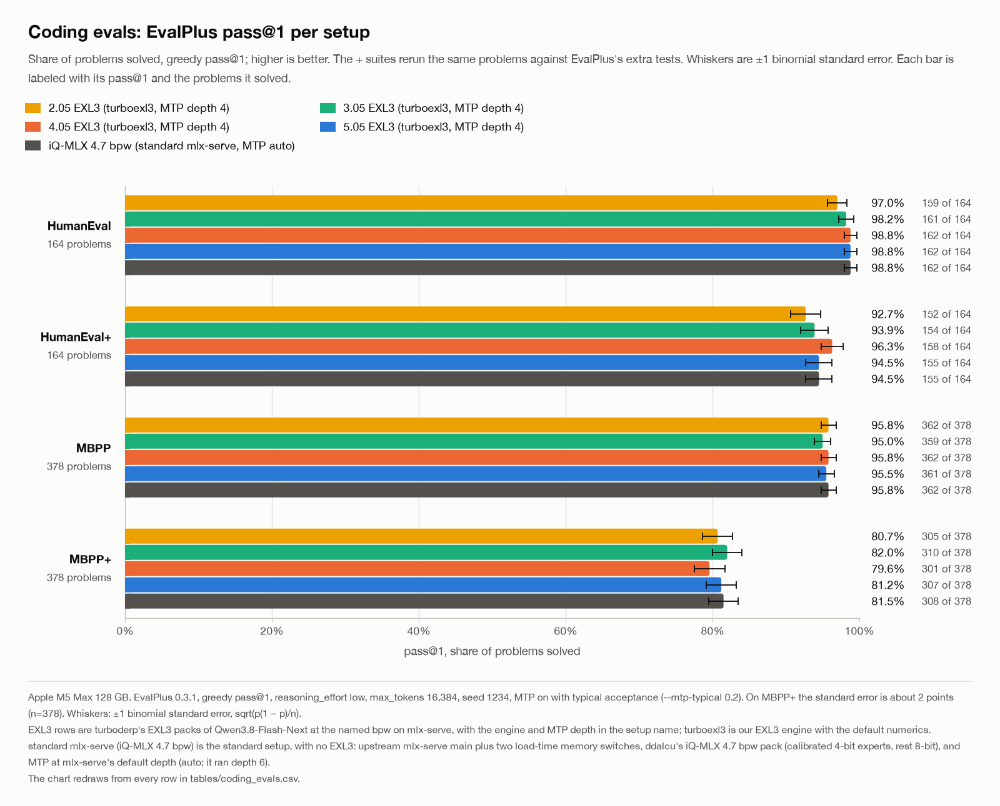

# Qwen3.8-Flash-Next

[Qwen3.8-Flash-Next](../../core/glossary.md#qwen38) is the model turboexl3 was written for: a mixture-of-experts model
(512 routed experts, top-10, a gated shared expert) with GatedDeltaNet and gated full-attention layers and an MTP head,
served from [turboderp](../../core/glossary.md#turboderp)'s EXL3 packs through mlx-serve.

What it runs on turboexl3:

| part of the model | entry points | kernels |
|---|---|---|
| routed experts | `moe` | the core's routed decode (form 9) and prefill chains ([engines](../../core/engines.md)) |
| shared expert and router at 1 to 4 decode rows | `moeFusedShared`, `moeFusedSharedRouted` | the shared and router heads in the core's decode launches ([kernels](kernels.md#1-shared-expert-and-router-inside-the-decode-launches-rows-14)) |
| trunk linears (GDN, attention, shared expert at prefill, `lm_head`, MTP) | `linear` and its pieces | the core's dense linear ([engines](../../core/engines.md#3-dense-projections)) |
| full-attention projections at prefill rows | `attnIn`, `attnPrep4`, `linearPreparedIdx`, `linearGated` | `src/models/qwen38/attn_io.zig` ([kernels](kernels.md)) |
| decode-row merges | `decode_merge.*` | `src/models/qwen38/decb.zig` ([kernels](kernels.md)) |
| the GDN tail at prefill rows | `gdnOutPrep` | `src/models/qwen38/gdn_out.zig` ([kernels](kernels.md)) |

The measured speed and coding scores: [results](results.md).

## The packs

turboexl3 is designed to work with the MLX versions of turboderp's packs. These are his EXL3 files, repacked into the
file layout that mlx-serve loads; nothing is quantized again. The repacks are made with
[qwen38-exl3-mlx-serve-converter](https://github.com/OpenSourceWTF/qwen38-exl3-mlx-serve-converter):

| bpw | turboderp's branch | MLX repack | download | n-gram table, not in the branch | KLD vs BF16 | perplexity |
|---|---|---|---:|---:|---:|---:|
| 2.05 | [2.05bpw_h4_ng4](https://huggingface.co/turboderp/Qwen3.8-Flash-Next-exl3/tree/2.05bpw_h4_ng4) | [OpensourceWTF/Qwen3.8-Flash-Next-exl3@2.05bpw](https://huggingface.co/OpensourceWTF/Qwen3.8-Flash-Next-exl3/tree/2.05bpw) | 36.85 GB | 26.24 GB | 0.0681 | 1.4871 |
| 3.05 | [3.05bpw_h5_ng5](https://huggingface.co/turboderp/Qwen3.8-Flash-Next-exl3/tree/3.05bpw_h5_ng5) | [OpensourceWTF/Qwen3.8-Flash-Next-exl3@3.05bpw](https://huggingface.co/OpensourceWTF/Qwen3.8-Flash-Next-exl3/tree/3.05bpw) | 52.72 GB | 32.64 GB | 0.0174 | 1.4074 |
| 4.05 | [4.05bpw_h6_ng6](https://huggingface.co/turboderp/Qwen3.8-Flash-Next-exl3/tree/4.05bpw_h6_ng6) | [OpensourceWTF/Qwen3.8-Flash-Next-exl3@4.05bpw](https://huggingface.co/OpensourceWTF/Qwen3.8-Flash-Next-exl3/tree/4.05bpw) | 68.59 GB | 39.04 GB | 0.0066 | 1.3897 |
| 5.05 | [5.05bpw_h6_ng6](https://huggingface.co/turboderp/Qwen3.8-Flash-Next-exl3/tree/5.05bpw_h6_ng6) | [OpensourceWTF/Qwen3.8-Flash-Next-exl3@5.05bpw](https://huggingface.co/OpensourceWTF/Qwen3.8-Flash-Next-exl3/tree/5.05bpw) | 84.38 GB | 39.04 GB | 0.0040 | 1.3848 |

The branches do not include the n-gram table: [the repo's card](https://huggingface.co/OpensourceWTF/Qwen3.8-Flash-Next-exl3#the-n-gram-table)
says where each one comes from. The KLD and perplexity columns are turboderp's, read from the charts on
[his model card](https://huggingface.co/turboderp/Qwen3.8-Flash-Next-exl3): the mean KL divergence D_KL(p_BF16 ‖
p_quant) and the perplexity over a self-generated in-domain trace (14,496 input and 45,588 output tokens), measured with
exllamav3 on his files. On that trace BF16 has a perplexity of 1.38474, and the KLD noise floor is 0.00262. The repacks
hold the same files, but these numbers were not measured through mlx-serve. The measured speed and coding scores with
mlx-serve are in [the results](results.md).

turboderp's charts, linked from [his model card](https://huggingface.co/turboderp/Qwen3.8-Flash-Next-exl3) (the EXL3 series is his plain quants; the packs above are its
2.05, 3.05, 4.05 and 5.05 points; EXL3-SC are his self-calibrated quants, the others are other formats he measured):

### Coding evals

EvalPlus 0.3.1 through mlx-serve on an M5 Max, the packs with turboexl3: greedy pass@1, `reasoning_effort: low`,
`max_tokens` 16,384, MTP on; solved problems in brackets, of 164 (HumanEval) and 378 (MBPP).

| pack | HumanEval | HumanEval+ | MBPP | MBPP+ |
|---|---:|---:|---:|---:|
| 2.05 bpw | 0.970 (159) | 0.927 (152) | 0.958 (362) | 0.807 (305) |
| 3.05 bpw | 0.982 (161) | 0.939 (154) | 0.950 (359) | 0.820 (310) |
| 4.05 bpw | 0.988 (162) | 0.963 (158) | 0.958 (362) | 0.796 (301) |
| 5.05 bpw | 0.988 (162) | 0.945 (155) | 0.955 (361) | 0.812 (307) |
| iQ-MLX 4.7 bpw, standard mlx-serve (no EXL3) | 0.988 (162) | 0.945 (155) | 0.958 (362) | 0.815 (308) |
| uncalibrated mixed 4/8-bit, superseded by the iQ pack | 0.988 (162) | 0.945 (155) | 0.952 (360) | 0.815 (308) |

Every pack is within two points of the standard pack on every suite.

The setups and the method in full: [the results](results.md#coding-evals).
